# LMS domain entity map · BASE02-A

Status: architectural documentation, 2026-11-04. No database or authoritative backend exists. This map defines conceptual identities, relationships and state owners; it specifies no storage types, tables, fields, ORM mappings, APIs or event infrastructure.

## Authority and scope

The direct BASE02-A instructions are recorded in [PD-013](../product/decisions.md#pd-013--base02-a-domain-policy-overrides). They supersede conflicting older policies only within the scope listed there. Other requirements and release allocations remain authoritative: [requirements](../product/requirements.md), [MVP/phases](../product/mvp.md), [open questions](../product/open-questions.md), [module boundaries](modules.md), and [ADR-0003](../decisions/0003-python-backend-architecture.md).

One modular monolith has seven authoritative domains and one future database. Existing runtime choices in ADR-0003 are neither reselected nor implemented here. Authentication provider and account-linking solution remain unselected. Frontend previews and empty backend directories are not domain implementations. Administration is an actor/workflow spanning owners, not an eighth domain.

### Policy reconciliation / decision log

The approved rules live once in PD-013; this table locates conflicting legacy statements for readers of this map.

| Subject | Older documentation | Current interpretation |
| --- | --- | --- |
| Roles | PD-011; requirements role section; root/backend instructions prohibit a manager role | PD-013 restores manager to the multi-role vocabulary. It does not approve manager permissions, a dashboard, routes or MVP commercial features. Historical partner attribution stays independent of current roles. |
| Activation | PD-004; requirements learning flow; module Learning section require introductory-page acknowledgment | Student's first authorized course opening activates that enrollment. Payment, grant and merely viewing a public product page do not activate it. Exact qualifying opening needs a feature contract (OQ-049). |
| Video duration | PD-004 and derived MVP/architecture prose give all courses three calendar months | Standard courses receive one year; mini-courses three months, from activation. Fourteen-day support applies only to supported courses. Calendar/timezone details remain OQ-049. |
| Refund eligibility | PD-010 and OQ-037 describe a proposed seven-day window regardless of progress | Request within 24 hours of payment **and** purchased course not started. A course is started when its enrollment activates. Boundary/race and multi-product/package cases stay open. |
| Refund execution | PD-010 and module refund flow require unattended approval/processing | Administration handles execution through Commerce. No unattended approval requirement is carried forward; approval mechanics and any automation assisting administration remain unspecified. Stripe remains the approved payment provider under PD-002. |
| Staff assignment | OQ-011/OQ-012 allow unresolved separation/multiple curators | One current trainer/curator per course. No multi-curator or cohort staffing is inferred; change-of-assignment history/visibility and author-versus-reviewer separation remain questions. |
| Homework history | PD-007 and derived scope suggest deleting homework at access end | Preserve every attempt, attachment, review and feedback through revisions, closure and refunds. Access expiry cannot itself authorize destroying this history. Eventual lawful deletion versus preservation needs OQ-008/OQ-094; no permanent-retention period is invented. |

Older workflow diagrams and runtime documents may still contain superseded product wording. Use PD-013 for those specific conflicts, including when reading AGENTS.md; their remaining architecture/security provisions are preserved. This task does not rewrite completed Vault records or delivery estimates.

## Identification and reference conventions

- Each entity below has a stable application-owned logical identity, issued by its owning domain. The names in the tables denote concepts, not proposed physical column names or ID types. No existing identifiers are claimed.
- Email, names, course titles, translated labels, slugs and URLs can change and never establish identity. A role membership refers to the same user across role contexts; guests have no authenticated user identity.
- Authentication links associate a provider-scoped subject with the internal user. A provider subject, session credential or payment-provider customer reference never replaces that user identity. Matching/linking identities requires approved policy, especially OQ-032.
- Order identity, order-line identity, payment identity, refund identity and enrollment identity are distinct. A payment confirmation grants neither an account role nor course activation by itself. A manual enrollment can exist without an online order/payment.
- Cross-domain references identify an owner-held fact. Consumers obtain authorized published facts and cannot mutate or independently reinterpret the referenced state. Repeated confirmations/grants must preserve the original outcome and provenance, not create duplicates.
- Language variants refer to one educational course identity unless a separately sold course is explicitly defined. Translation/audio selection does not silently create another purchase, enrollment, clock or completion history; language-specific entitlement policy remains OQ-024.
- Historical commercial terms, learning evidence and certificate issuance evidence remain referable after mutable catalog/profile/role changes. The governing content version for existing enrollments remains OQ-022/OQ-023/OQ-028.

## Ownership matrix

| Authoritative domain | Sole state authority | Authorized initiators / consumed facts | Boundary |
| --- | --- | --- | --- |
| Identity | User/account status, profile, authentication links, sessions, role memberships and capabilities | User registration/profile/recovery; admin role/block workflows; verified authentication provider facts | Supplies trusted actor context. Resource owners still authorize each action. |
| Catalog | Category/course/lesson definitions, order, localized content, course staffing, offers, package composition, content/price approval and independent publication/sale/archive states | Assigned trainer authors/proposes; admin approves/publishes/assigns | Archiving or stopping sales does not revoke Learning rights. Homework definitions remain Assignments-owned. |
| Commerce | Cart/quote, order/lines, payment confirmation, refund eligibility/execution state, commercial manual-sale evidence, promotions, attribution, compensation and payout records | Buyer checkout/refund request; verified provider confirmations; authorized admin execution/corrections | Consumes Learning activation to assess refunds; requests grants/revocations from Learning. Owns money, not access. |
| Learning | Enrollment, activation, video/material/support rights, pauses/extensions/revocation, enrollment staffing relationship, playback/progress/unlocking and course completion | Student opening/playback; admin grants/access changes; assigned curator support extension; Commerce fulfillment/refund fact; Assignments acceptance facts | Applies Catalog rules and published assignment facts. Cannot accept homework or issue certificates. Current time and owner-held state govern access, not a notification. |
| Assignments | Homework definitions/mandatory-work status, attempt history, attachments, reviews/feedback and review deadlines | Authorized student submits; assigned curator or admin reviews; Learning supplies entitlement/support facts | Expired support does not cancel timely-work review obligations. Does not set enrollment expiry or certificate eligibility. |
| Certificates | Eligibility evaluation/review queue, templates, certificate identity/number, issuance evidence/file and later verification/revocation | Automatic evaluation of published learning/assignment facts; admin evidence review/manual issuance | Every course type needs manual issuance; eligibility is not issuance. Source facts remain owned by Learning/Assignments. |
| Notifications | Notification intent, template/rendering, delivery attempts/outcomes and persistent admin alerts | Owner-published facts; approved recipient/channel rules; delivery-provider responses | Delivery failure never changes payment, access, submission or certificate state. |

Course staffing is Catalog's current course assignment. Learning records the applicable enrollment relationship; Assignments preserves the actual reviewer and curator-timezone context of each attempt. These are historical/contextual references, not competing current staffing authorities. Reassignment propagation must be decided before implementing it. Business audit semantics belong to each action owner; operational logs/reporting are technical/read-only compositions, not extra business owners.

## Domain relationship diagram

Edges show conceptual references and cardinalities, not physical foreign keys. `0..*` includes absence before a lifecycle starts; unresolved bounds are stated in the entity tables.

```mermaid
flowchart LR
    U["Identity: User"] -->|"1 : 0..*"| RM["Role membership"]
    U -->|"1 : 0..*"| AL["Authentication link"]
    CAT["Catalog: Category"] -->|"1 : 0..*; multi-category TBD"| C["Course / mini-course"]
    U -->|"one current trainer/curator per course"| C
    C -->|"1 : 0..*"| V["Language variant"]
    C -->|"1 : 0..* ordered"| LES["Lesson"]
    PK["Package"] -->|"1 : multiple inclusions"| PI["Package inclusion"]
    PI -->|"each refers to one"| C
    PI -. "optional module; policy TBD" .-> MOD["Start in USA module"]
    U -->|"1 buyer : 0..*"| O["Commerce: Order"]
    O -->|"1 : 1..*"| OL["Order line"]
    OL -->|"one purchased offering"| OFFER["Course / package / module offer"]
    OFFER -->|"refers to applicable definition"| C
    OFFER -->|"or"| PK
    OFFER -->|"or"| MOD
    O -->|"1 : 0..* attempts"| PAY["Payment"]
    PAY -->|"1 : 0..* requests; scope TBD"| REF["Refund"]
    ATTR["Attribution / promotion"] -->|"commercial provenance"| O
    MAN["Manual grant evidence"] -->|"no online payment required"| E["Learning: Enrollment"]
    OL -->|"0..*; package expands"| E
    U -->|"1 student : 0..*"| E
    E -->|"each refers to one"| C
    E -->|"1 : applicable video/support rights"| AR["Access right"]
    E -->|"1 : 0..*"| LP["Lesson progress"]
    LP -->|"each refers to one"| LES
    LES -->|"0..*; upper bound TBD"| HW["Assignments: Homework definition"]
    HW -->|"1 : 0..*"| ATT["Submission attempt"]
    E -->|"1 : 0..*"| ATT
    ATT -->|"1 : 0..*"| MEDIA["Attachment"]
    ATT -->|"1 : 0..*; decision rules TBD"| REV["Review / feedback"]
    E -->|"completion evidence"| ELIG["Certificates: Eligibility"]
    REV -->|"mandatory-work facts"| ELIG
    ELIG -->|"admin issuance; language/reissue TBD"| CERT["Certificate"]
    O -. "later financial basis" .-> COMP["Commerce: Accrual / payout"]
    REF -. "later reversal" .-> COMP
    N["Notifications: Intent / delivery"] -. "consumes facts from each owner" .-> O
    N -. "consumes facts" .-> ATT
    N -. "consumes facts" .-> CERT
```

The offer node connects to the course/package/module definitions above; it represents sellable terms, not a separate eighth domain. Notifications also consumes Identity/Learning/Catalog facts as required by the event table.

## Core entity contracts

All transitions below are conceptual business states, not binding enum definitions. Each row supplies purpose, logical identity, relationships, owner/actors, lifecycle, phase and unresolved dependencies. **M** = MVP, **P2/P3** = later product phase. A conditional entity is not permission to implement unresolved policy.

### Identity and Catalog

| Entity / logical identity | Purpose and relationships | State owner; authorized initiators; lifecycle | Phase / dependencies |
| --- | --- | --- | --- |
| User/account — user identity | Stable person/account boundary; one user has many memberships, purchases and enrollments; profile belongs to that user | Identity; user registers/updates permitted profile, admin blocks/unblocks; verification/recovery workflows control their own states. Blocking denies protected use without erasing history | M; provider unselected, OQ-016/OQ-032; richer profile P2 |
| Role membership / capability grant — membership or grant identity within a user | Many memberships per user; vocabulary student, trainer, manager, administrator. Guest is unauthenticated. Membership is separate from referral attribution | Identity; authorized admin assigns/removes; granted → removed, retaining required audit. A role never grants ownership of all course/student records | M multi-role foundation; manager commercial actions P2, actual permissions/scope OQ-092; switching OQ-013/OQ-014 |
| Authentication link and session — link identity / session identity | User has zero or more provider links and sessions; every link associates one provider-scoped subject with one user | Identity; verified sign-in/link/recovery/logout and admin blocking; sessions become usable, expire or are revoked. Link/deduplication policy not selected | M authentication; social links P3; OQ-032; no provider selected |
| Category/direction — category identity | Organizes courses; category has zero or more courses. Whether a course can span categories is not settled | Catalog; admin creates/edits/archives. Taxonomy changes preserve historical product references | M; OQ-017; multi-category cardinality remains unspecified |
| Course, including mini-course — course identity | Educational unit with ordered lessons, available languages, category and one current trainer/curator assignment. Mini-course is a course kind with distinct completion/access rules, not a duplicate enrollment system | Catalog; assigned trainer authors/proposes, admin approves content/prices/publishes. Draft/unapproved → approved/published; visibility, sale state and archive state independent. Mini-course has no curator support | M; publication readiness PD-009; staffing cardinality one, mini-course attribution details and separation OQ-011; advanced eligibility OQ-018; content versions OQ-022/OQ-023 |
| Offer / price proposal — offer or proposal identity | Approved sellable terms for one product; Commerce consumes terms and preserves purchased terms independently | Catalog; trainer proposes price, admin approves/rejects and controls sale. No proposal becomes a charge without approval | M courses; P2 packages; PD-002 USD/no subscriptions; cap/taxes OQ-029 |
| Course language variant — variant identity within course | One course may provide RU/EN metadata/audio/subtitles; variant refers to the same course and relevant media/lessons | Catalog; authorized author supplies, admin approves/publishes available content. Missing translation is not fabricated | M available-language disclosure/media; full localization P2; OQ-024/OQ-088; no language-purchase allocation inferred |
| Lesson — lesson identity within course | Exactly one owning course; ordered among its lessons; zero or more media/material references and homework definitions | Catalog; trainer authors, admin approves/reorders and configures sequential unlocking. Publication requires complete required content. Definition state is separate from a student's progress | M; assignment upper bound OQ-020, ordering/version OQ-022/OQ-023 |
| Course media/material version — media/material identity and version identity | Lesson/variant references approved video or downloadable material; sharing cardinality unselected | Catalog; trainer/admin uploads, processing reports ready/failed, only admin publishes. Failure preserves previous published version | M PD-003/PD-009; Learning authorizes consumption; processing technology not modeled here |
| Package and inclusion — package identity / inclusion identity | Package has multiple included offerings; each inclusion points to one course or optional module; courses can appear in multiple packages | Catalog; admin assembles, prices, approves and publishes; independent sale/archive controls preserve purchased history | P2; sizes/composition/overlap/change policy OQ-025–028; no package access clock |
| Optional module, including Start in USA — module identity | Optional educational/catalog offering that may be included in a package; its lesson structure and standalone sale/support/completion policy need definition | Catalog owns definition/publication; admin authorizes content. Learning/Certificates own any eventual entitlement/eligibility states | P2 package context; OQ-019/OQ-025/OQ-053. “Module” here is product content, not another backend domain |

### Commerce and Learning

| Entity / logical identity | Purpose and relationships | State owner; authorized initiators; lifecycle | Phase / dependencies |
| --- | --- | --- | --- |
| Cart / quote — cart or quote identity | Buyer selection and authoritative payable offer for one checkout; anonymous selection resolves to buyer under approved matching rules | Commerce; guest/student selects, owner validates price/consents before payment. Abandonment is not an order/payment | M; persistence OQ-033; package upgrades/promotions P2 |
| Order and order line — order identity / line identity | One resolved buyer per order; one or more lines per completed purchase; each line preserves one purchased offering. Single-course line normally yields one intended enrollment; package line can yield several | Commerce; buyer initiates, verified payment authorizes fulfillment. Unpaid/pending → paid/fulfilled; failed/cancelled payment does not fulfill. Refund is a separate linked lifecycle | M; payment-state mapping OQ-031, multi-item/partial policy OQ-036; package expansion P2 |
| Payment attempt / confirmation — payment identity | Order has zero or more payment attempts; internal payment reference remains distinct from external provider payment/customer/event references | Commerce validates provider facts; pending → confirmed, failed or cancelled. Browser return cannot confirm. Disputes/reversals require policy | M PD-002; OQ-031; duplicate provider confirmation has one fulfillment outcome |
| Refund request / execution — refund identity | Linked to original payment/order and affected purchased course/enrollment; repeated requests/provider replies do not imply multiple monetary refunds | Commerce owns eligibility and money state; student requests, admin handles execution, provider confirms. Requested → eligible or rejected; eligible → processing → confirmed or failed. Requires request within 24 hours of payment AND unactivated course | M PD-013; OQ-037 residual legal/execution details, OQ-093 time/race semantics; partial/package allocation OQ-036 |
| Manual access grant / manual sale evidence — grant identity / commercial-record identity | Grant identifies student, course, responsible admin and reason/provenance. Verified offline sale additionally retains payment evidence/operator/attribution in Commerce; no fake online payment required | Learning owns enrollment grant; admin initiates. Commerce owns commercial evidence if sale-backed; authorize and record → grant; suspension/reversal through owners | M admin grant under PD-010; offline commercial workflow P2, OQ-038/OQ-039. Complimentary pricing/refund/commission policy not inferred |
| Promotion, referral partner/link and sale attribution — promotion / partner / link / attribution identities | Promotion may refer to partner and eligible products. Order/manual sale retains historical attribution to partner/user despite later role changes | Commerce; admin configures permitted promotions/rates, authorized partner uses link, owner evaluates attribution. Valid/expired/exhausted code; attribution/reversal history preserved | P2; OQ-034–041/OQ-092; membership alone gives no lead, contact, financial or manual-sale permission |
| Enrollment — enrollment identity | One student and one course; paid source references order line, manual source references grant evidence. Student/course can have historical enrollments; repeat ownership policy is unapproved | Learning; Commerce requests paid grant, admin manual grant, student first authorized opening activates once. Granted/unactivated → activated; access may expire, pause, restore or be revoked without deleting enrollment | M; duplicate/repeat/package ownership OQ-026/OQ-028; applicable staffing references Catalog assignment |
| Video/material access right and curator-support right — right identity scoped to enrollment | Independent rights within one enrollment. Standard video: one year from activation; mini video: three months. Supported course: 14 calendar days support; mini has no support right. Materials follow video deadline under preserved PD-004 | Learning alone grants/activates/evaluates expiry/revokes. Admin changes either deadline/pauses/restores; assigned curator may extend support up to 14 days/request, including after expiry, never video. Pauses preserve exact remaining applicable duration | M enforcement, richer countdown P2; OQ-049 calendar/pause overlap; optional-module rules OQ-019. Support extension does not extend video |
| Extension request — request identity within enrollment | Student request linked to support/video right and authorized decision; remains requestable after support expiry | Learning; student requests, assigned curator decides permitted support extension or admin handles broader exception. Requested → resolved; rejection vocabulary/evidence still unspecified | M PD-004/PD-010; OQ-049/OQ-090; no inferred unlimited extension policy |
| Lesson progress / playback state — progress identity within enrollment and lesson | Per-learner state, independent of lesson definition and homework decision; includes resume position and completion evidence | Learning; authorized student playback/activity, owner applies approved viewed/completed/unlock rule. Unstarted → in progress → completed when rule met; resume/rewatch does not itself accept homework | M; OQ-021/OQ-042 block completion threshold and sequential prerequisites |
| Course completion — completion identity within enrollment | Derived learning outcome from course rules and owner-published facts. Main/advanced: all mandatory assignments accepted; mini: all mandatory lessons completed | Learning records outcome from published Assignments acceptance or its own lesson completion; it cannot alter those source facts. Incomplete → completed; Certificates separately evaluates eligibility and issuance evidence | M; OQ-021/OQ-022/OQ-048; no automatic reopening/invalidation or certificate revocation policy |

### Assignments, Certificates and Notifications

| Entity / logical identity | Purpose and relationships | State owner; authorized initiators; lifecycle | Phase / dependencies |
| --- | --- | --- | --- |
| Homework definition — assignment identity and applicable definition/version identity | Belongs to lesson/course; defines work and mandatory status. Zero or more attempts per assignment/enrollment; lesson upper bound remains open | Assignments baseline ownership; authorized trainer authors/admin controls mandatory work, Catalog consumes readiness. Definition changes need approval and historical rule/version policy | M; relocation not approved (SITE009/WORK001); OQ-020/OQ-022/OQ-023 |
| Submission attempt — attempt identity within enrollment/assignment | Each submission/resubmission is distinct; links previous attempts and preserves submitted comment/files. Assignment's current status is a summary of its attempts/reviews, not replacement history | Assignments; authorized student submits; pending review → accepted or revision requested. Resubmission creates new pending attempt, preserving earlier decision. Each attempt has independent PD-008 deadline/timezone evidence | M; OQ-045 pending edits, OQ-046 due dates, OQ-048 post-expiry revisions. Managers have no inferred review rights |
| Submission attachment — attachment identity associated with attempt | Attempt has zero or more private photo/video attachments, with original and derived copies distinguished; no fixed count cap, total originals and each file limited to 1 GB | Assignments; student uploads/previews/removes/replaces before submission as permitted; processing pending → ready/failed/retry. Preserve originals until processing succeeds and preserve submitted history | M PD-005; OQ-043/OQ-044/OQ-045; retention OQ-008/OQ-094 |
| Review and feedback — review identity / feedback identity within review or attempt | Review refers to one attempt and actual reviewer; text feedback preserved. Comments and decisions retained; number of decisive reviews/conflict rules need contract | Assignments; assigned curator or authorized admin comments/accepts/requests revision. Admin review does not reassign curator. Timely work remains owed review after support expiry; overdue is deadline condition, not loss of pending state | M text; voice P2; PD-008 48 counted weekday hours, reminders 24/12/6/1 and overdue; OQ-048/OQ-079/OQ-080 |
| Eligibility evaluation / review case — evaluation identity for enrollment and applicable evidence | References Learning completion/progress, Assignments accepted work and governing course rules; certificate readiness separate from learning completion | Certificates automatically evaluates, queues eligible case; admin inspects evidence. Not eligible → eligible/awaiting review; issuance requires separate authorized action | M; OQ-021/OQ-048/OQ-051/OQ-052; package/module rules OQ-019/OQ-053 |
| Certificate template — template identity / approved version identity | Default academy template or approved custom template; language and issuance evidence refer to applicable approved version | Certificates; admin manages/selects approved assets; unapproved template cannot authorize production issuance | M RU/EN as supplied; OQ-006/OQ-024/OQ-051/OQ-052; no invented legal text/assets |
| Certificate — certificate identity and distinct unique certificate number | References enrollment, evidence, approved name/course/trainer/template/language and issued artifact. Course/user has zero or more historical certificates; exact language/reissue multiplicity unapproved | Certificates; admin reviews and manually issues once per approved issuance basis; issued record retained. Download does not recalculate from mutable profile. Revocation/supersession later, subject to policy | M manual issuance; P3 QR/public verification; OQ-051–057. Refund does not automatically revoke certificate |
| Notification intent / delivery attempt — intent identity / attempt identity | Business fact identifies intended recipient/message; one intent can have multiple delivery attempts; external message reference stays provider-scoped | Notifications; authorized owner fact creates intent, delivery provider reports outcome. Pending → delivered or failed/retried; persistent admin alert handling does not resolve underlying business work | M launch emails/review reminders/admin alerts; P2 broader operational messages, P3 push; OQ-069/OQ-070/OQ-090 |

## Later capabilities within the existing owners

| Concept / logical identity | Purpose, relationships and sole state owner | Actors, lifecycle and phase | Unresolved policy |
| --- | --- | --- | --- |
| Compensation rate, accrual and payout — rate / accrual / payout identities | Commerce owns trainer per-student main-course accruals, mini-course sales-share accruals, manager/partner commission and reconciliation. Each accrual traces beneficiary, commercial/enrollment basis and refund corrections; payout groups attributable accruals | P2; admin configures/reconciles/marks paid with date; beneficiary sees permitted own records. Accrued → paid; linked refund correction preserves history | OQ-058–064; trigger, rates, bases, allocation and payout method unapproved. Historical $25/30%/10% examples are not defaults to adopt |
| Lead / abandoned-cart follow-up — lead or follow-up identity | Commerce owns consent-gated acquisition/contact history and assignments; references buyer/cart/partner without becoming Identity | P2; separately authorized operator/admin acts; status vocabulary, assignment/contact permissions not defined | OQ-065–067/OQ-092; manager role supplies no automatic contact permission |
| Course conversation / message — conversation / message identities | Learning owns enrollment-scoped discussion, separate from Assignments feedback; participants student and assigned curator, admin inspection as authorized | P2 full messaging; send while support permits; post-expiry reading unsettled. MVP monitoring minimum remains blocked | OQ-047/OQ-068/OQ-090; preserve history, OQ-094 applies |
| Public review — review identity | Catalog owns later course-rating/moderation facts, separate from homework review | P3; eligible student submits, admin moderates; eligibility/moderation transitions not approved | OQ-071/OQ-072 |
| Recommendations and reporting — no new independent transactional identity required yet | Catalog supplies approved product suggestions; technical read compositions aggregate owner-held facts for reports. Commerce remains financial authority; analytics is not learning/commercial state authority | P2 operational/financial reports and consented acquisition analytics; P3 recommendations; admin/authorized readers only | OQ-073–077; model/identity/event taxonomy deliberately deferred |

Policy publication is the one deliberately unresolved ownership dependency inherited from SALE002: the future policy-document/version owner must be chosen **once within the seven domains** before implementation. Commerce already owns checkout-acceptance evidence (one acceptance refers to user/order and an immutable approved policy version); PD-006 requires all four acknowledgments and selected-language availability. Do not invent a parallel owner or legal texts. Account deletion is Identity-coordinated, while each domain controls eligible deletion of its own records. Audit evidence follows each action owner and applicable retention/legal holds.

## Lifecycle scenarios

| Scenario / phase | Trace and ownership boundary | Unresolved gate |
| --- | --- | --- |
| **A. Guest purchase — M** | Guest selects course → Commerce validates offer/consents and initiates payment → provider confirmation is verified by Commerce → Identity resolves/creates application user → Commerce fulfills purchase and asks Learning to grant enrollment once → Notifications delivers receipt/access/account instructions. Enrollment remains unactivated | Account resolution may occur earlier in checkout; do not merge by email alone (OQ-032). OQ-031 authoritative provider state; no paid purchase fulfillment while identity unresolved |
| **B. Package purchase — P2** | Commerce preserves purchased package terms → confirmed payment → Learning grants intended included-course enrollments → each activates independently on first opening and has its own applicable support/video rights. Optional module follows its eventual policy | OQ-019/OQ-025–028/OQ-036/OQ-053; no duplicate-access, proration, package refund, shared clock or package certificate rule inferred |
| **C. Admin manual enrollment — M grant; P2 offline sale** | Identity authenticates authorized admin → Learning records grant provenance and grants enrollment without online payment → Notifications sends access instructions. If sale-backed, Commerce retains required commercial/payment evidence and attribution | OQ-038/OQ-039 define offline evidence/accounting/approval; no fabricated paid order. Non-sale grant does not automatically earn commissions |
| **D. First opening — M** | Student opens authorized enrolled course → Learning checks block/revocation and performs activation once → standard video/material access starts for one year, mini for three months; supported course starts separate 14-calendar-day support → further openings preserve initial activation | OQ-049 qualifying opening, exact calendar boundaries/timezone/pause overlaps; opening is not lesson completion (OQ-021) |
| **E. Revision cycle — M** | Student submits attempt A → Assignments preserves files/context and starts 48 counted weekday-hour review deadline → assigned curator requests revision with feedback → student submits attempt B when permitted → new independent deadline → curator/admin accepts → Assignments publishes accepted-work fact. Attempts A/B and every review remain available as authorized | OQ-045 pending replacement, OQ-048 revision after expiry, OQ-043/OQ-044 media recovery/security |
| **F. Refund — M single course** | Student requests → Commerce checks payment time plus Learning activation → eligible only within 24 hours AND unstarted → admin handles execution → verified confirmed refund → Commerce asks Learning to revoke affected rights immediately → Notifications reports outcome. Outside window or activated course → rejected request; no monetary reversal or new revocation from rejection | OQ-093 inclusive boundary, request-vs-execution evaluation and concurrent activation; OQ-037 legal/execution details, OQ-036 package/partial refunds. Preserve financial/learning/homework records; later accrual correction belongs to Commerce |
| **G. Support expiry — M** | Learning closes support at its own deadline while video/material access remains active until its distinct deadline → Assignments blocks disallowed new work while retaining pending states and duty to review timely submissions → authorized extensions through Learning only | OQ-048 revisions/certificate effects, OQ-047 message visibility; no reset of video timer or deletion of homework |
| **H. Completion/certificate — M** | Assignments confirms all required homework accepted for main/advanced course, or Learning confirms mini required lessons completed → Learning records course completion → Certificates evaluates evidence/eligibility and queues case → admin inspects and manually issues → Notifications delivers readiness notice | OQ-021/OQ-022/OQ-048/OQ-051/OQ-052; completion never itself generates an issued certificate |
| **I. Trainer and student roles — M foundation** | One Identity user has both memberships → Catalog/Assignments permit only assigned teaching/review resources → Learning permits only own student enrollments → each operation checks relevant role/capability and resource relationship | OQ-013/OQ-014/OQ-092; self-review, self-enrollment grants and other separation-of-duties cases not approved. Manager commercial participation remains P2 |

Refund revocation is an access transition, not a record deletion. Learning prevents protected viewing/playback/material access and disallowed mutations; Assignments, Commerce and Certificates preserve their evidence under the applicable retention policy. Neither failed notification nor catalog archiving restores/revokes entitlement. Account blocking denies protected use independently of the enrollment's historical lifecycle.

## Conceptual events and reactions

Names are descriptive facts only: no binding payloads, event bus, outbox or event database is defined. Producers publish only their own completed state changes; consumers cannot treat a requested action as a confirmed outcome. Authorization-critical grant/revocation must be coherent with the financial outcome; a delayed optional reaction cannot allow unauthorized access.

| Conceptual fact | Producer / trigger | Interested domains and intended outcome | Phase |
| --- | --- | --- | --- |
| Account resolved / role membership changed / account blocked | Identity completes authorized workflow | Commerce resolves buyer; resource owners use current actor status; Notifications sends approved account notices. Never rewrite historic attribution | M; manager actions P2 |
| Course published / sale availability changed | Catalog admin approves and changes publication/sale state | Commerce consumes sellable terms; public presentation consumes published content. Learning preserves prior entitlements | M |
| Payment confirmed | Commerce verifies authoritative provider confirmation | Learning receives intended paid-grant request; Identity resolves buyer as needed; Notifications sends receipt/payment confirmation; later Commerce financial capability evaluates approved accrual rules | M; finance P2 |
| Enrollment granted | Learning completes authorized paid/manual grant | Notifications delivers enrollment/access instructions; Commerce records fulfillment result. No activation timer starts | M |
| Course activated | Learning records first authorized opening | Commerce consumes started-course fact for refund eligibility; Notifications uses only approved activation-related messages. Learning starts applicable independent clocks | M |
| Support expired / access paused, restored, expired or revoked | Learning applies applicable current entitlement rule/admin decision | Assignments enforces permitted actions and timely-review duty; enabled conversations follow Learning rights; Notifications handles approved messages/alerts. No automatic history destruction | M enforcement; richer notices P2 |
| Homework submitted / resubmitted | Assignments accepts distinct attempt | Notifications alerts assigned curator; Assignments owns new review deadline; admin monitoring consumes status | M |
| Review reminder due / review overdue | Assignments determines PD-008 deadline condition | Notifications delivers 24/12/6/1-hour reminders and overdue notices, plus persistent admin overdue alert. Pending work remains in queue | M |
| Submission reviewed | Assignments records review/feedback | Notifications informs student; Learning consumes mandatory-work acceptance facts; Certificates may reevaluate evidence. Revision requested does not mark lesson/course completed | M |
| Lesson completed / course completed | Learning validates approved progress/completion rules | Certificates reevaluates eligibility; operational views consume progress. No automatic issuance | M; completion semantics blocked where OQ-021 applies |
| Certificate eligible | Certificates evaluates sufficient evidence | Certificates queues admin evidence review; any notice depends on approved template. It does not mean issued | M |
| Certificate issued | Certificates completes admin-authorized issuance | Notifications sends certificate-ready notice; student sees issued artifact; public verification consumes approved projection later | M; public verification P3 |
| Refund processed (confirmed) | Commerce verifies monetary refund result | Learning immediately revokes affected rights; Notifications communicates result; later Commerce financial capability corrects linked accruals/commissions. No automatic certificate revocation | M; finance P2 |
| Policy published / changed | Publication owner pending SALE002; authorized publication under PD-006 | Commerce consumes approved immutable version for checkout; Notifications alerts affected students; existing Learning access continues | M, blocked ownership/content |

## Open questions and verification

The active question register remains [open-questions.md](../product/open-questions.md), not a second decision register here. The main implementation blockers are OQ-021/OQ-042 completion/unlocking, OQ-031/OQ-032 payment/account matching, OQ-037/OQ-093 refund boundaries/execution, OQ-048/OQ-049 post-expiry/calendar/activation details, OQ-051/OQ-052 certificate evidence, OQ-008/OQ-094 preservation/deletion, and SALE002 policy-publication ownership. Manager permissions and release allocation remain OQ-092; package/finance questions block their later capabilities only. Actual legal texts, entity/identity readiness and other existing launch checks remain required.

BASE02-A verification scope:

- Cross-checked the current repository instructions, product requirements, complete PD-002–PD-012 entries, phase plan, open questions, module contracts, ADR-0003 and integration contract; inspected empty backend status and disconnected Catalog source.
- All seven authoritative domains have one state owner; course staffing, financial fulfillment, learning activation, homework approval, completion, certificate eligibility and issuance are distinguished. Policy publication is explicitly blocked rather than assigned speculatively.
- Relationships, conceptual identities, lifecycles, authorized actors, phase/dependencies, nine scenarios A–I and conceptual event reactions are covered above. Unknown multiplicities remain labeled.
- No database schema, physical identifiers, migrations, APIs, runtime dependencies or application behavior is delivered. Existing unrelated working-tree changes are outside this task. Evidence is this file plus PD-013 and the updated question register; no commit is implied.
- Documentation checks passed: relative file links, whitespace, balanced fences, unique question IDs, A–I scenario coverage, seven-owner coverage and a physical-design token scan. `git diff --check` passed for the touched tracked documentation; source/test/package/backend file hashes matched the pre-edit snapshot. Mermaid was reviewed as source, not rendered. Frontend/backend runtime checks were skipped because this task changes documentation only and the backend is not initialized.
