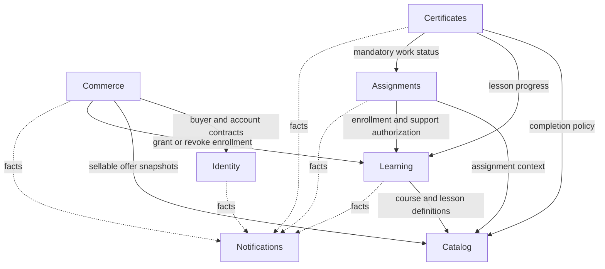
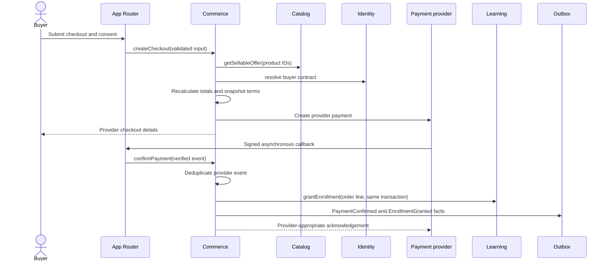
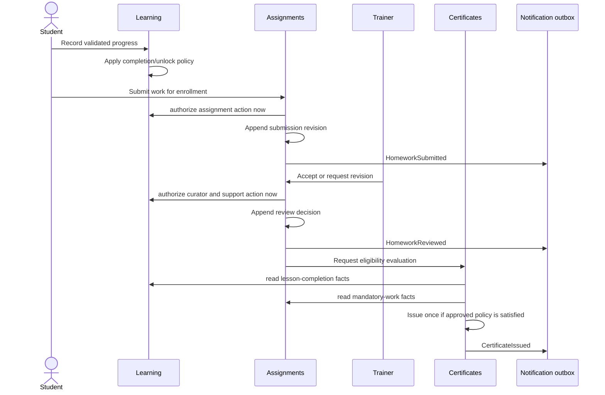
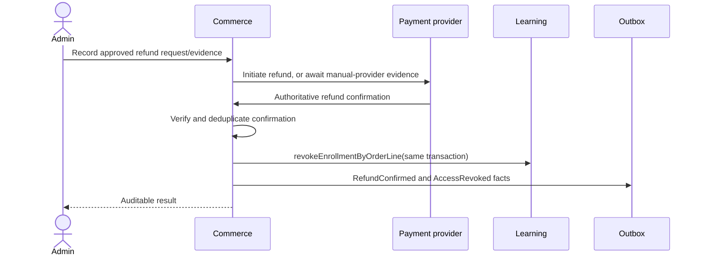

# Module ownership and workflows

## Purpose

This document turns the modular-monolith decision into enforceable ownership and
dependency rules. It must be read with the [architecture overview](./overview.md),
[product requirements](../product/requirements.md), [delivery scope](../product/mvp.md),
and [open questions](../product/open-questions.md).

The boundaries below are architectural decisions. Business values that the product
documents leave open stay open. A module may expose a configurable seam for an
unresolved policy, but must not silently choose the policy.

The secure workflows below include server-enforced support expiration and immediate
access revocation after a confirmed refund because the requested architecture must
support them. Their placement in MVP is still a scope correction pending
product-owner approval in `docs/product/mvp.md`; this document does not approve it.

## Boundary vocabulary

- A **public interface** is an exported command, query, DTO, or event type from
  `src/features/<module>/index.ts` or another explicitly documented public entry
  point.
- An **internal implementation** is every other file in a module. It may change
  without coordinating consumers.
- A **command** asks the owning module to change its state.
- A **query** asks the owning module for the minimum fact needed by a use case.
- A **domain event** is an immutable fact committed by the owner. It is for durable
  follow-up work, not a remote microservice protocol.
- A **workflow owner** coordinates one use case but does not acquire ownership of
  records in the modules it calls.

## Module map



Solid arrows are synchronous public-interface dependencies. Dotted arrows are
durable facts consumed for delivery side effects. Notifications has no reverse
domain dependency.

## Ownership summary

| Module | Owns authoritative state | Does not own |
| --- | --- | --- |
| Identity | Accounts, credentials/provider links, sessions, verification/reset state, block state, roles, profile and locale, certificate-name inputs | Enrollment, purchases, course assignments, manager attribution |
| Catalog | Directions, products, course and lesson definitions, ordering, localization metadata, publication/sale state, prices/offers, package composition, protected content references | Purchased-price history, enrollment/progress, student submissions |
| Commerce | Carts, checkout calculations, commercial snapshots, consent evidence, orders and lines, payment attempts/events, refunds, promo usage, manager attribution, manual-enrollment evidence | Course content, account credentials, learning access state |
| Learning | Enrollments/entitlements, access and support windows, curator assignment for an enrollment, lesson progress, playback position, sequential-access decisions | Catalog definitions, payment records, assignment reviews, certificate files |
| Assignments | Homework definitions, mandatory status/version, submissions and revisions, private submission assets, reviews, feedback, review assignment and deadlines | Course/lesson content, general enrollment, certificate issuance |
| Certificates | Eligibility evaluation record, certificate number, issuance snapshot, generated file reference, language/template reference, revocation/supersession history | Source progress, assignment decisions, profile editing |
| Notifications | Notification intent, templates and localized render versions, recipient/channel preferences when approved, delivery jobs, attempts, provider message IDs and outcomes | The business fact that triggered a message, payment or access state |

An identifier from another module may be stored as a reference. That does not grant
permission to update or reinterpret the referenced record.

## Module responsibilities

### Identity

Identity authenticates users and produces the actor context used by other modules.
It owns multi-role membership and account block state. Its public interface should
support narrow operations such as `requireActor`, `getBuyerIdentity`,
`getCertificateName`, and audited role administration.

Identity does not decide whether a user may access a particular course,
submission, order, lead, or certificate. The resource-owning module combines the
actor identity with its own relationships. Identity must never accept a
client-provided role set.

Open policies include role switching and prohibited role combinations (OQ-013 and
OQ-014), blocked-user residual behavior (OQ-016), guest-checkout matching (OQ-032),
and later social account linking.

### Catalog

Catalog is the source for what can be discovered, sold, and learned. It owns
directions, product kinds, course/lesson structure, localized presentation,
publication, prices, package composition, and references to approved course media.
It exposes immutable offer and course-definition projections instead of its raw
tables.

Commerce requests an authoritative sellable-offer snapshot and stores the required
commercial facts on an order line. Learning asks for lesson order and completion
policy. Assignments validates that an assignment belongs to an existing
course/lesson. Historical purchases and completions must not change merely because
the current catalog changes; version/snapshot behavior remains a product decision
under OQ-022, OQ-023, and OQ-028.

Catalog must not read carts, enrollment progress, or submissions to decide its own
state. Read models may compose those facts for administration without changing
ownership.

### Commerce

Commerce owns the money-facing lifecycle from cart through confirmed payment,
refund, attribution, and commercial audit evidence. It recalculates price and
eligibility on the server and never trusts client totals, role, discount, or
ownership assertions.

Commerce is the workflow owner for paid enrollment and refund. It asks Catalog for
a current offer snapshot, Identity for the buyer/account contract, and Learning to
grant or revoke access. The shared database transaction provides atomicity; a
committed outbox fact triggers receipt and access notifications.

Browser success redirects do not confirm payment. Only a verified authoritative
provider event may fulfill an order. Provider choice and several state transitions
remain blocked by OQ-001 and OQ-029 through OQ-041.

### Learning

Learning owns a student's entitlement and progress through course content. An
enrollment is the resource boundary for access, support, curator assignment, and
source order-line provenance. Learning decides whether a student may view a lesson
or material, receive a playback grant, update progress, or participate in an
enrollment-scoped operation.

Learning consumes Catalog definitions but does not copy current Catalog state into
authority at request time when a historical enrollment snapshot should govern.
Exactly which version governs is blocked by OQ-022 and OQ-023.

The support clock and recorded-content clock are separate concepts even if a
future product decision gives them the same start. Exact ownership level, start,
pause, extension, expiry, and timezone rules are blocked by OQ-003 and OQ-049.
Authorization must evaluate the current clock synchronously; a scheduled expiry job
is not the security boundary.

Learning records lesson progress and playback resume position. The event that marks
a lesson complete and unlocks the next lesson remains blocked by OQ-021 and OQ-042.

### Assignments

Assignments owns homework requirements and the append-only history of student
submissions, revisions, media, review decisions, and feedback. It obtains course
and lesson context from Catalog and asks Learning whether the actor and enrollment
may perform the requested action.

A new submission or revision is never an in-place overwrite of history. Review
state transitions are explicit and concurrency checked so two curator actions
cannot both win. The module exposes narrow completion facts, such as whether every
mandatory assignment for a particular completion-policy version is accepted.

Assignment cardinality, replacement/deletion, deadlines, media limits, curator SLA,
and post-support-expiry transitions remain open under OQ-004, OQ-005, OQ-020,
OQ-043 through OQ-049. No implementation may collapse an in-review submission into
an undefined state at expiry.

### Certificates

Certificates evaluates eligibility from an explicit Catalog completion policy,
Learning progress, Assignments acceptance facts, and the Identity certificate name.
It owns issuance, unique numbering, the immutable display snapshot, generated PDF
reference, and later revocation/verification state.

The evaluation is idempotent for a student, enrollment, course-policy version, and
certificate language. Once issued, the certificate records the facts used; it is
not rendered from mutable current profile or catalog values on every download.

Certificate fields, language/name selection, issue date, template assets, reissue,
package behavior, public verification, and refund effects are unresolved under
OQ-051 through OQ-057. Until approved, the module may define interfaces and tests
around placeholders but must not issue production certificates based on guessed
rules.

### Notifications

Notifications turns committed business facts into delivery attempts. It owns
template rendering, channel dispatch, deduplication, retry, provider response, and
delivery status. It does not decide that payment succeeded, support expired, work
was accepted, or a certificate became eligible.

Producers write a business event to the transactional outbox. A worker passes the
fact to Notifications, which creates one idempotent job per approved recipient,
template, channel, locale, and triggering event. A delivery failure never rolls
back an already-confirmed payment or review; it is retried and surfaced
operationally.

Exact timing, preferences, unsubscribe, localization, channel, retry, and retention
rules remain open under OQ-069 and OQ-070. MVP templates are limited by
`docs/product/mvp.md`.

## Allowed dependencies

The table lists synchronous imports. `Public` means only the target's public entry
point; `No` means compose at an entry point/read model or introduce a reviewed
public contract rather than importing internals.

| From / To | Identity | Catalog | Commerce | Learning | Assignments | Certificates | Notifications |
| --- | --- | --- | --- | --- | --- | --- | --- |
| Identity | — | No | No | No | No | No | No |
| Catalog | Public, only for trainer/admin identity references when required | — | No | No | No | No | No |
| Commerce | Public | Public | — | Public commands | No | No | No direct call; publish fact |
| Learning | Public actor contract | Public | No | — | No | No | No direct call; publish fact |
| Assignments | Public actor contract | Public | No | Public | — | No | No direct call; publish fact |
| Certificates | Public name contract | Public | No | Public | Public | — | No direct call; publish fact |
| Notifications | Public recipient/locale projection only | No | No | No | No | No | — |

Identity actor types used everywhere should be exported from Identity or a tiny
shared type-only contract. Consumers must not import session storage or role-table
implementations.

An application entry point may compose read-only queries from multiple public
interfaces for a dashboard. It must not become a business-rule home. If composition
changes state, one feature service is named the workflow owner and invokes other
modules' public commands within an explicit transaction.

## Cross-module communication rules

1. **Prefer a local typed call for a decision needed now.** Price validation,
   entitlement authorization, and certificate eligibility cannot wait for eventual
   delivery.
2. **Use a committed fact for follow-up side effects.** Email, reminders, provider
   follow-up, and reporting projection updates consume outbox events.
3. **Do not expose repositories across modules.** The owner exports a use-case
   command or query.
4. **Do not write another module's table.** This remains true inside a shared
   transaction.
5. **Do not build a generic event bus abstraction first.** Start with explicit event
   records and handlers required by concrete workflows.
6. **Version public event payloads when durable consumers exist.** Include an event
   ID, type, occurred-at time, producer, aggregate reference, and minimal payload.
7. **Keep personal and financial data out of broad events.** Prefer identifiers;
   consumers obtain an authorized narrow projection if needed.
8. **Avoid cycles.** If two modules appear to need each other's internals, extract
   the missing fact into the correct owner contract or move workflow coordination
   to the initiating service.

## Critical workflows

### Purchase to payment confirmation to enrollment

Commerce owns this workflow.



Required invariants:

- the current server-side offer and legal-consent versions are validated before a
  payment attempt;
- a unique provider event can be accepted more than once but applied once;
- each fulfilled order line maps idempotently to at most one intended enrollment;
- failed, cancelled, incomplete, unsigned, or merely browser-reported payments do
  not grant access;
- the order, payment confirmation, enrollment, and outbox facts commit atomically
  when the selected persistence technology permits the proposed shared transaction;
- email delivery occurs after commit and may retry independently.

Product decisions OQ-001, OQ-029 through OQ-032, and OQ-037 must shape the final
state machine. Package and attribution behavior additionally depends on OQ-025
through OQ-028 and OQ-034 through OQ-041.

### Lesson completion to assignment review to certificate

Certificates owns the final eligibility evaluation; Learning and Assignments own
their respective facts.



The request to evaluate may be a direct post-commit call or an outbox-driven job;
issuance remains idempotent either way. Main/advanced courses require all approved
mandatory work; mini-courses rely on approved lesson completion rules. The Start in
the USA module and package certificate behavior remain undefined.

No final state machine may be implemented until the applicable OQ-021, OQ-042,
OQ-048, OQ-049, OQ-051, and OQ-052 answers are approved. Later certificate behavior
also depends on OQ-053 through OQ-057.

### Support expiration and authorization

Learning owns the support entitlement; the module performing an action owns its
business transition.

This is the target authorization boundary. Its MVP scope remains pending the
product-owner approval recorded in the product documentation.

For every submission, revision, review, or enabled course message:

1. authenticate the current actor;
2. load the target resource by its opaque ID without revealing whether an
   unauthorized record exists;
3. ask Learning for the current enrollment, assignment, curator relationship, and
   support authorization using the server clock;
4. apply the action-specific transition rule in the owning module;
5. recheck version/concurrency conditions and commit;
6. record an audit fact for sensitive overrides or administrative extensions.

Support expiration is evaluated on request. A delayed scheduled job must not allow
an expired action. Jobs are useful for warnings, read models, and operational
visibility only.

What happens to in-review work, student revisions, message history, extensions,
reassignment, materials, and the clock itself remains blocked by OQ-003 and
OQ-047 through OQ-050. The model must preserve every pre-expiry submission and its
history while those decisions are pending.

### Refund to access revocation

Commerce owns refund confirmation; Learning owns access state.

This is the secure target flow. Immediate revocation in MVP remains a scope
correction pending product-owner approval.



Required invariants:

- only an authorized administrator can record/approve the platform action;
- monetary confirmation, not intent alone, triggers the required revocation;
- repeated confirmation is a no-op with the original result;
- revocation blocks lessons, materials, playback grants, and protected learning
  mutations immediately at server authorization boundaries;
- commercial and learning history is retained and linked to actor, order, refund,
  enrollment, confirmation, and timestamp;
- later trainer/manager accrual reversal consumes the confirmed-refund fact;
- notification or reporting failure does not restore access.

Partial refunds and multi-product allocation are blocked by OQ-036. Product
documentation does not approve automatic deletion of submissions or automatic
certificate revocation after refund; neither should occur until retention and
certificate policy is decided.

## Practical folder organization

Start with the smallest folders required by a feature. A mature module may look
like this; empty layers should not be created speculatively:

```text
src/features/learning/
  index.ts                         # reviewed public exports only
  domain/
    enrollment.ts                 # aggregate/state transitions
    access-policy.ts              # pure authorization policy
  application/
    grant-enrollment.ts           # one use case
    revoke-enrollment.ts
    get-lesson-access.ts
  data/
    enrollment-repository.ts      # interface used by this module
    db-enrollment-repository.ts   # server-only implementation
  integrations/
    video-playback-port.ts
    provider-video-playback.ts    # selected provider adapter
  ui/
    course-progress.tsx
    lesson-player.tsx             # Client Component only if interaction needs it
  __tests__/
    access-policy.test.ts
    grant-enrollment.test.ts
```

App Router entry points compose this module without owning its rules:

```text
src/app/
  (student)/courses/[courseId]/page.tsx
  (student)/courses/[courseId]/loading.tsx
  (student)/courses/[courseId]/error.tsx
  api/video/[assetId]/playback/route.ts
```

A smaller module should remain smaller. For example, a single query may be
`src/features/catalog/get-public-course.ts` plus a test and an export; it does not
need empty `domain`, `application`, or `data` directories.

## Import examples

Allowed:

```ts
import { getSellableOffer } from "@/features/catalog";
import { grantEnrollment } from "@/features/learning";
```

Not allowed:

```ts
import { catalogDb } from "@/features/catalog/data/catalog-db";
import { enrollmentTable } from "@/features/learning/internal/schema";
```

Feature UI may import generic primitives from `@/components/ui`. Generic UI must
not import a feature. Shared technical code in `src/lib` must not import feature
modules. `src/db` must not contain business workflows.

Avoid barrel exports inside private folders. The root `index.ts` is a reviewed
capability boundary, not an export of every module file.

## Data and schema rules

Schema files may be physically centralized under `src/db/schema` if required by
the selected migration tool, but each file and table has one named feature owner.
A practical layout is:

```text
src/db/
  client.ts
  transaction.ts
  migrations/
  schema/
    identity.ts
    catalog.ts
    commerce.ts
    learning.ts
    assignments.ts
    certificates.ts
    notifications.ts
```

Only the owning feature repository writes the corresponding schema. Foreign keys
may cross ownership boundaries, but cascade deletion must not erase retained
commercial, educational, audit, or certificate evidence. Cross-module transaction
coordination passes an opaque transaction context to public commands; it does not
pass raw tables or query builders.

Audit semantics stay with the action owner. Shared audit persistence may record
actor, action, target, time, correlation, and safe before/after metadata, but the
feature defines which action is auditable and which sensitive fields must be
omitted. Exact audit scope and retention remain blocked by OQ-079 and OQ-008.

## Boundary review checklist

Before merging a feature change, verify:

- the changed state has one named owner;
- external callers use the owner's public entry point;
- the initiating entry point is thin and all untrusted input is validated;
- authentication and resource authorization occur at the protected operation;
- no browser code imports server-only persistence or provider code;
- no module writes another module's tables;
- synchronous consistency is not delegated to a best-effort event;
- external side effects happen after commit and are idempotent;
- unresolved product questions are referenced rather than answered in code;
- tests cover direct unauthorized access, valid state changes, conflicts, and
  replay for critical operations.
