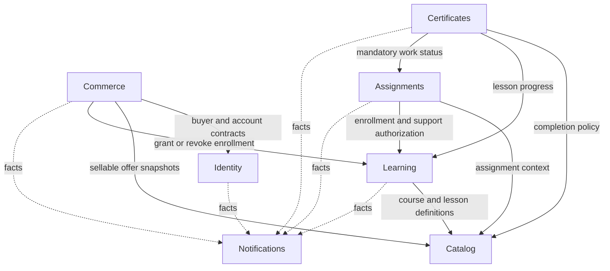
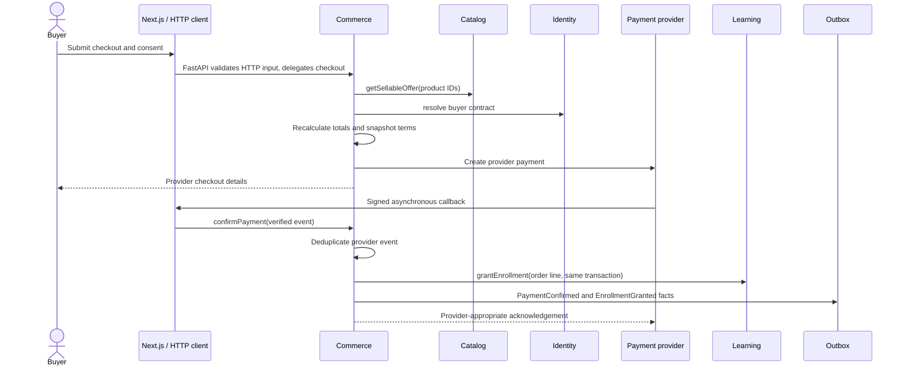
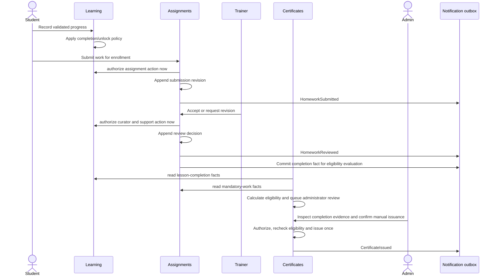
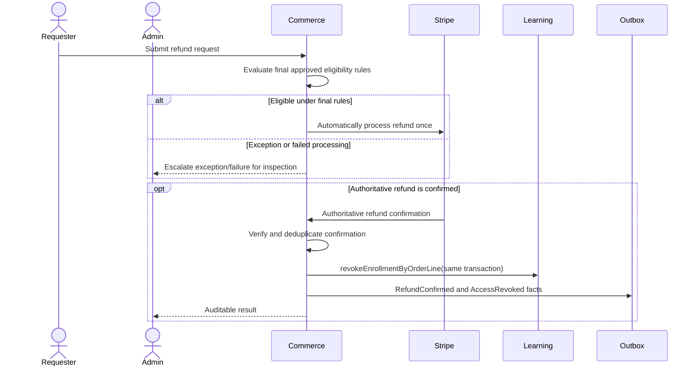

# Module ownership and workflows

## Implemented presentation versus target domains · 2026-11-03

[ADR-0003](../decisions/0003-python-backend-architecture.md) moves the planned backend to Python without changing the seven ownership boundaries below. `backend/app/modules` contains empty directories only. No authoritative authentication, database, payment, access, media, review or notification service exists.

Existing presentation owners remain `home`, `catalog`, `course-detail`, `public-shell`, `identity`, `commerce`, `component-preview`. PublicHeader consumes AuthModal/CartPreview; home consumes CourseCard/CategoryNavigation and shared CatalogProvider state; details map preview records into existing DetailProduct presentation. These are frontend dependencies, not domain APIs. Demo data/control requires `TEST_PREVIEW=true`; false/missing stays unavailable. The retired TypeScript Catalog contained only types, checks and an unconnected source. Temporary view types/disconnected handling now live in the Catalog feature; defensive indexability lives under SEO. See [migration evidence](../qa/python-backend-migration-2026-11-03.md).

Public Site owns presentation; Catalog supplies approved publication data; Commerce owns authoritative cart/quotes/payment and checkout-acceptance evidence; Identity owns authentication. Administration uses existing domain interfaces, never direct table writes. Policy-publication ownership requires SALE002; homework-definition ownership keeps the Assignments baseline pending SITE009/WORK001. No eighth domain, manager role, new route or production integration is introduced. Frontend fixtures and historical audits do not establish release acceptance.

## Purpose

This document turns the modular-monolith decision into enforceable ownership and
dependency rules. It must be read with the [architecture overview](./overview.md),
[product requirements](../product/requirements.md), [delivery scope](../product/mvp.md),
and [open questions](../product/open-questions.md).

The boundaries below are architectural decisions. Business values that the product
documents leave open stay open. A module may expose a configurable seam for an
unresolved policy, but must not silently choose the policy.

The secure workflows below follow approved PD-004 / OQ-003 for server-enforced
support/access deadlines and revocation on refunds/closure, with PD-007 retention.
Detailed refund and post-expiration policies remain unresolved under OQ-036,
OQ-037, OQ-048 and OQ-049.

## Boundary vocabulary

- A **public interface** is an exported command, query, DTO, or event type from
  `backend/app/modules/<domain>` through a documented narrow Python entry (for example `public.py` when actual consumers require it). HTTP clients use FastAPI/OpenAPI, not Python imports.
- An **internal implementation** is every other file in a module. It may change
  without coordinating consumers.
- A **command** asks the owning module to change its state.
- A **query** asks the owning module for the minimum fact needed by a use case.
- A **domain event** is an immutable fact committed by the owner. It is for durable
  follow-up work, not a remote microservice protocol.
- A **workflow owner** coordinates one use case but does not acquire ownership of
  records in the modules it calls.

## Module map



Solid arrows are synchronous public-interface dependencies. Dotted arrows are
durable facts consumed for delivery side effects. Notifications has no reverse
domain dependency.

## Ownership summary

| Module | Owns authoritative state | Does not own |
| --- | --- | --- |
| Identity | Accounts, credentials/provider links, sessions, verification/reset state, block state, roles and explicit capability grants, profile and locale, certificate-name inputs | Enrollment, purchases, course assignments, referral-partner attribution |
| Catalog | Directions, products, course and lesson definitions, ordering, localization metadata, publication/sale state, prices/offers, package composition, protected content references | Purchased-price history, enrollment/progress, student submissions |
| Commerce | Carts, checkout calculations, commercial snapshots, consent evidence, orders and lines, payment attempts/events, refunds, accepted policy-version references (publication owner pending SALE002), promo usage, partner identity/links, attribution/commission ledgers, manual-enrollment evidence | Course content, account credentials, learning access state |
| Learning | Enrollments/entitlements, access and support windows, curator assignment for an enrollment, lesson progress, playback position, sequential-access decisions, course-scoped conversations | Catalog definitions, payment records, assignment reviews, certificate files |
| Assignments | Homework definitions, mandatory status/version, submissions and revisions, private submission assets, reviews, feedback, review assignment and deadlines | Course/lesson content, general enrollment, certificate issuance |
| Certificates | Eligibility evaluation record, certificate number, issuance snapshot, generated file reference, language/template reference, revocation/supersession history | Source progress, assignment decisions, profile editing |
| Notifications | Notification intent, templates and localized render versions, recipient/channel preferences when approved, delivery jobs, attempts, provider message IDs and outcomes | The business fact that triggered a message, payment or access state |

An identifier from another module may be stored as a reference. That does not grant
permission to update or reinterpret the referenced record.

## Module responsibilities

### Identity

Identity authenticates users and produces the actor context used by other modules.
It owns multi-role membership and account block state. Its public interface should
support narrow operations such as `requireActor`, `getBuyerIdentity`,
`getCertificateName`, and audited role administration.

Identity does not decide whether a user may access a particular course,
submission, order, lead, or certificate. The resource-owning module combines the
actor identity with its own relationships. Identity must never accept a
client-provided role set.

Open policies include role switching and prohibited role combinations (OQ-013 and
OQ-014), blocked-user residual behavior (OQ-016), guest-checkout matching (OQ-032),
and later social account linking.

### Catalog

Catalog is the source for what can be discovered, sold, and learned. It owns
directions, product kinds, course/lesson structure, localized presentation,
publication, prices, package composition, and references to approved course media.
PD-009 requires MVP category add/edit/archive and trainer course/lesson/material
authoring for assigned courses. Trainers propose prices; administrators approve
content/prices and independently control visibility, sale availability and archiving.
Publication validates all required lessons/video/materials/homework and a
trainer-curator for every supported course (not mini-courses). No minimum launch
course count is an engineering invariant. Sales pauses/archiving do not revoke
existing Learning entitlements.
It exposes immutable offer and course-definition projections instead of its raw
tables.

Commerce requests an authoritative sellable-offer snapshot and stores the required
commercial facts on an order line. Learning asks for lesson order and completion
policy. Assignments validates that an assignment belongs to an existing
course/lesson. Historical purchases and completions must not change merely because
the current catalog changes; version/snapshot behavior remains a product decision
under OQ-022, OQ-023, and OQ-028.

Catalog must not read carts, enrollment progress, or submissions to decide its own
state. Read models may compose those facts for administration without changing
ownership.

### Commerce

Commerce owns the money-facing lifecycle from cart through confirmed payment,
refund, attribution, and commercial audit evidence. It recalculates price and
eligibility on the server and never trusts client totals, role, discount, or
ownership assertions.

Commerce is the workflow owner for paid enrollment and refund. It asks Catalog for
a current offer snapshot, Identity for the buyer/account contract, and Learning to
grant or revoke access. The shared database transaction provides atomicity; a
committed outbox fact triggers receipt and access notifications.

Browser success redirects do not confirm payment. Only a verified authoritative
provider event may fulfill an order. PD-002 selects Stripe embedded Payment Element,
USD and eligible cards/wallets/Klarna one-time purchases; no subscriptions in any
planned phase. State transitions and other commercial policies remain blocked by
OQ-029 through OQ-041. Commerce retains immutable legal-version acceptance evidence
and verifies all four PD-006 acknowledgments before payment. Commerce owns checkout acceptance evidence. The owner of policy documents, approval/publication and immutable source versions remains a SALE002 preparation decision within the seven domains. Frontend policy management stays in its own feature; this refactor does not approve the previously proposed ownership choice.
PD-010 requires automatic Stripe approval/processing of eligible refund requests
without administrator approval; exceptions/failures escalate to administrators.
Final eligibility is blocked by OQ-037: the seven-day window remains proposed.
Do not infer a manual-only MVP substitute or a final refund rule.

### Learning

Learning owns a student's entitlement and progress through course content. An
enrollment is the resource boundary for access, support, curator assignment, and
source order-line provenance. Learning decides whether a student may view a lesson
or material, receive a playback grant, update progress, or participate in an
enrollment-scoped operation.

Learning consumes Catalog definitions but does not copy current Catalog state into
authority at request time when a historical enrollment snapshot should govern.
Exactly which version governs is blocked by OQ-022 and OQ-023.

PD-004 requires independent support/access deadlines per purchased course/enrollment.
Both activate when the student explicitly marks the introductory rules page viewed:
14 consecutive calendar days of support and 3 calendar months of course access.
Assigned curators can extend support up to 14 calendar days per request, including
requests after support expiry, but cannot extend course access. Administrators may
change both deadlines, approve longer exceptions and pause access. Freeze applicable
timers and restore exact remaining duration. Support extensions never implicitly
extend access. Remaining calendar/timezone and overlapping-extension rules require
explicit treatment without inventing policy; OQ-049 remains a dependency.
Authorization must evaluate the current clock synchronously; a scheduled expiry job
is not the security boundary.

Learning records lesson progress and playback resume position. The event that marks
a lesson complete and unlocks the next lesson remains blocked by OQ-021 and OQ-042.

### Assignments

Assignments owns homework requirements and the append-only history of student
submissions, revisions, media, review decisions, and feedback. It obtains course
and lesson context from Catalog and asks Learning whether the actor and enrollment
may perform the requested action.

A new submission or revision is never an in-place overwrite of history. Review
state transitions are explicit and concurrency checked so two curator actions
cannot both win. The module exposes narrow completion facts, such as whether every
mandatory assignment for a particular completion-policy version is accepted.

PD-005 sets media formats, limits, normalization, resumability and private delivery.
PD-004 requires curator review of work submitted before the permitted deadline,
even when overdue. PD-007 governs eventual deletion and outstanding-review holds.
Assignment cardinality, already-submitted replacement/deletion, submission deadlines and
detailed post-expiry transitions remain under OQ-020 and OQ-043 through OQ-049.
PD-008 fixes the review SLA at 48 counted hours, Monday–Friday continuously,
excluding weekends and including public holidays. Snapshot the assigned curator
timezone per submission/resubmission; each starts its own deadline and retains
review history. Display in viewer-local time. Assignments calculates deadlines
server-side and emits durable notification facts immediately, at 24/12/6/1 hours
remaining and overdue, with replay/concurrency protection. Overdue work remains
queued; Notifications delivers persistent auditable admin alerts. Administrators
can comment/accept/request revisions without changing the assigned curator.
PD-001 and OQ-048/OQ-079/OQ-080 remain applicable. No implementation may collapse
in-review work into an undefined state or erase required history at expiry.

### Certificates

Certificates evaluates eligibility from an explicit Catalog completion policy,
Learning progress, Assignments acceptance facts, and the Identity certificate name.
It owns eligibility evaluation, the administrator review queue, manual issuance,
unique numbering, immutable display snapshot, generated PDF reference and later
revocation/verification state. Under PD-010, automatic eligibility never issues a
certificate: an administrator inspects completion evidence and manually issues
every certificate, including mini-courses. Use the approved default academy
template unless an approved custom template is assigned. Audit the issuing actor
and prevent duplicates; correction/revocation/reissuance remain separate policies.

The evaluation is idempotent for a student, enrollment, course-policy version, and
certificate language. Once issued, the certificate records the facts used; it is
not rendered from mutable current profile or catalog values on every download.

Certificate fields, language/name selection, issue date, template assets, reissue,
package behavior, public verification, and refund effects are unresolved under
OQ-051 through OQ-057. Until approved, the module may define interfaces and tests
around placeholders but must not issue production certificates based on guessed
rules.

### Notifications

Notifications turns committed business facts into delivery attempts. It owns
template rendering, channel dispatch, deduplication, retry, provider response, and
delivery status. It does not decide that payment succeeded, support expired, work
was accepted, or a certificate became eligible.

Producers write a business event to the transactional outbox. A worker passes the
fact to Notifications, which creates one idempotent job per approved recipient,
template, channel, locale, and triggering event. A delivery failure never rolls
back an already-confirmed payment or review; it is retried and surfaced
operationally.

Exact timing, preferences, unsubscribe, localization, channel, retry, and retention
rules remain open under OQ-069 and OQ-070. MVP templates are limited by
`docs/product/mvp.md`.

## Allowed dependencies

The table lists synchronous Python module imports; frontend access is HTTP only. `Public` means only the target's public entry
point; `No` means compose at an entry point/read model or introduce a reviewed
public contract rather than importing internals.

| From / To | Identity | Catalog | Commerce | Learning | Assignments | Certificates | Notifications |
| --- | --- | --- | --- | --- | --- | --- | --- |
| Identity | — | No | No | No | No | No | No |
| Catalog | Public, only for trainer/admin identity references when required | — | No | No | No | No | No |
| Commerce | Public | Public | — | Public commands | No | No | No direct call; publish fact |
| Learning | Public actor contract | Public | No | — | No | No | No direct call; publish fact |
| Assignments | Public actor contract | Public | No | Public | — | No | No direct call; publish fact |
| Certificates | Public name contract | Public | No | Public | Public | — | No direct call; publish fact |
| Notifications | Public recipient/locale projection only | No | No | No | No | No | — |

Identity actor types used everywhere should be exported from Identity or a tiny
shared dependency-light Python contract. Consumers must not import session storage or role-table
implementations.

An application entry point may compose read-only queries from multiple public
interfaces for a dashboard. It must not become a business-rule home. If composition
changes state, one feature service is named the workflow owner and invokes other
modules' public commands within an explicit transaction.

## Cross-module communication rules

1. **Prefer a local typed call for a decision needed now.** Price validation,
   entitlement authorization, and certificate eligibility cannot wait for eventual
   delivery.
2. **Use a committed fact for follow-up side effects.** Email, reminders, provider
   follow-up, and reporting projection updates consume outbox events.
3. **Do not expose repositories across modules.** The owner exports a use-case
   command or query.
4. **Do not write another module's table.** This remains true inside a shared
   transaction.
5. **Do not build a generic event bus abstraction first.** Start with explicit event
   records and handlers required by concrete workflows.
6. **Version public event payloads when durable consumers exist.** Include an event
   ID, type, occurred-at time, producer, aggregate reference, and minimal payload.
7. **Keep personal and financial data out of broad events.** Prefer identifiers;
   consumers obtain an authorized narrow projection if needed.
8. **Avoid cycles.** If two modules appear to need each other's internals, extract
   the missing fact into the correct owner contract or move workflow coordination
   to the initiating service.

## Critical workflows

### Purchase to payment confirmation to enrollment

Commerce owns this workflow.



Required invariants:

- the current server-side offer and legal-consent versions are validated before a
  payment attempt;
- a unique provider event can be accepted more than once but applied once;
- each fulfilled order line maps idempotently to at most one intended enrollment;
- failed, cancelled, incomplete, unsigned, or merely browser-reported payments do
  not grant access;
- the order, payment confirmation, enrollment, and outbox facts commit atomically
  within the shared PostgreSQL transaction;
- email delivery occurs after commit and may retry independently.

PD-002 and unresolved OQ-029, OQ-031, OQ-032 and OQ-037 must shape the final
state machine. Package and attribution behavior additionally depends on OQ-025
through OQ-028 and OQ-034 through OQ-041.

### Lesson completion to assignment review to certificate

Certificates owns the final eligibility evaluation; Learning and Assignments own
their respective facts.



An outbox-driven job requests evaluation through the Certificates public interface;
eligibility evaluation remains idempotent either way; PD-010 issuance requires
manual administrator review/authorization. Main/advanced courses require acceptance
of all mandatory homework; mini-courses require completion of all mandatory lessons.
Issuance and its audit record must be duplicate-protected. The Start in
the USA module and package certificate behavior remain undefined.

No final state machine may be implemented until the applicable OQ-021, OQ-042,
OQ-048, OQ-049, OQ-051, and OQ-052 answers are approved. Later certificate behavior
also depends on OQ-053 through OQ-057.

### Support expiration and authorization

Learning owns the support entitlement; the module performing an action owns its
business transition.

This is the MVP authorization boundary approved by PD-004. Timely-submitted work
must remain reviewable by its authorized curator even after support expires.

For every submission, revision, review, or enabled course message:

1. authenticate the current actor;
2. load the target resource by its opaque ID without revealing whether an
   unauthorized record exists;
3. ask Learning for the current enrollment, assignment, curator relationship, and
   support authorization using the server clock;
4. apply the action-specific transition rule in the owning module;
5. recheck version/concurrency conditions and commit;
6. record an audit fact for sensitive overrides or administrative extensions.

Support expiration is evaluated on request. A delayed scheduled job must not allow
an expired action. Jobs are useful for warnings, read models, and operational
visibility only.

PD-004 settles activation, durations, extension permissions, pauses, materials
expiry and the obligation to review timely submissions. Detailed post-expiry
transitions, revisions, message-history visibility and reassignment remain under
OQ-047 through OQ-049. Preserve required history and outstanding reviews under
PD-007 while those questions and legal retention checks remain pending.

### Refund to access revocation

Commerce owns refund confirmation; Learning owns access state.

This is the secure MVP flow under PD-004 access revocation. OQ-036/OQ-037
still block detailed refund and recovery policy.



Required invariants:

- authorize the request and evaluate final eligibility server-side; eligible refunds
  require no administrator approval, while exceptions/failures escalate (PD-010);
- monetary confirmation, not intent alone, triggers the required revocation;
- repeated confirmation is a no-op with the original result;
- revocation blocks lessons, materials, playback grants, and protected learning
  mutations immediately at server authorization boundaries;
- commercial and learning history is retained and linked to actor, order, refund,
  enrollment, confirmation, and timestamp;
- later trainer/partner accrual reversal consumes the confirmed-refund fact;
- notification or reporting failure does not restore access.

Partial refunds and multi-product allocation are blocked by OQ-036. Refund must
not trigger unconditional deletion of submissions: apply PD-007 retention and
review/legal holds. Automatic certificate revocation after refund remains
unapproved pending certificate policy.

## Essential administration and operational presentation

PD-010 requires the MVP dashboard to compose owner-module public interfaces for
permitted user data, block/unblock and access controls, order/refund exceptions,
manual certificate issuance, content/pricing publication and course monitoring.
Administrators inspect progress, submissions/history/deadlines, course-scoped
conversations and student-request statuses. Routine business operations must not
require developer intervention; infrastructure recovery/server management is
outside the interface. Account creation and role assignment use separately
defined authorized workflows. Do not grant new role powers from a generic admin
flag or direct table writes.

Sensitive administrative operations require a consequence-explaining confirmation
popup and explicit confirmation, followed by server enforcement and audit of actor,
action, resource, timestamp and outcome. A confirmation dialog is not authorization.
The separate admin-restricted operational/error-log route supports date, severity,
operation, resource and reference-ID search/filtering, readable descriptions and
privacy-safe diagnostics. Routine retention is 30 days under PD-007. Literal URL,
viewer implementation owner and notification-center implementation remain planning
details, not newly approved routes or a new domain module.

## Practical folder organization

Follow [ADR-0003](../decisions/0003-python-backend-architecture.md). The [backend tree](../../backend/README.md#directory-conventions) is currently empty. Future placement examples, not files to scaffold:

```text
src/features/learning/
  learning-page.tsx
  sections/01-course-list/course-list-section.tsx
  sections/02-lesson/components/lesson-player.tsx
backend/app/modules/learning/
  router.py                 # thin FastAPI HTTP mapping
  schemas.py                # Pydantic input/output schemas
  models.py                 # owned SQLAlchemy mappings
  service.py                # operations and explicit transaction participation
  policies.py               # framework-independent rules where practical
  persistence.py            # optional focused private query/write adapter
  public.py                 # optional narrow entry for actual module consumers
backend/app/api/             # version/router composition
backend/app/db/              # engine/session/transaction/metadata plumbing
backend/app/jobs/            # durable execution wiring, not policy
backend/alembic/versions/    # reviewed schema history with domain owners
src/app/                    # Next.js routes and optional thin transport adapters
```

Create only files with real responsibilities. Keep frontend paths/numbered sections in place; frontend features need not mirror backend domains. No generic repositories per table, mandatory base services or empty layers. Scope and future testing instructions live in [backend/AGENTS.md](../../backend/AGENTS.md).

## Import and API boundaries

A Python Commerce operation may call Catalog's documented public offer query or Learning's public enrollment command using the workflow transaction. It must not import another domain's models, persistence helpers or private adapters. Domain policies should not depend on FastAPI or SQLAlchemy where practical. Technical core/db/jobs helpers do not become workflow owners.

Next.js Server Components/actions call FastAPI HTTP operations using future generated contracts, never Python functions or authoritative tables. Client-facing UI barrels cannot re-export server credential/transport code. Existing temporary Catalog view types are presentation/preview compatibility; generated OpenAPI contracts replace transport assumptions at real integration. See [frontend/backend integration](frontend-backend-integration.md).

## Data and schema rules

Domain `models.py` owns SQLAlchemy mappings; `backend/app/db` assembles shared metadata and session infrastructure without moving record ownership. Alembic revisions under `backend/alembic/versions` name affected owners and preserve a coordinated schema history. Do not use `src/db` for authoritative persistence. PostgreSQL is selected; Neon is intended hosting, with driver/pooling configuration still pending.

Only the owning domain writes its records. Foreign keys may cross ownership boundaries, but cascades must not erase retained commercial, educational, audit or certificate evidence. Cross-domain transactions pass an explicit context to public commands, not raw tables/query builders; participating operations do not independently commit. Keep external effects outside long transactions and commit durable facts atomically with state. Use database constraints and concurrency checks for duplicate/conflicting operations.

Audit semantics stay with the action owner. Shared audit persistence may record
actor, action, target, time, correlation, and safe before/after metadata, but the
domain defines which action is auditable and which sensitive fields must be
omitted. PD-007 fixes routine-error/admin-log retention at 30 days, encrypted
restricted backups at 30 days, and permanent certificate records/verification
evidence. Critical audits follow legally required periods. Audit classification
and mandatory retention/legal exceptions remain under OQ-079 and residual OQ-008.
Identity deletion must check active courses and verified identity, notify
administrators and coordinate eligible deletion through each module owner.
Restoration must not unintentionally restore deleted personal data.

## Boundary review checklist

Before merging a feature change, verify:

- the changed state has one named owner;
- external callers use the owner's public entry point;
- the initiating entry point is thin and all untrusted input is validated;
- authentication and resource authorization occur at the protected operation;
- neither Next.js nor browser code accesses authoritative tables or imports backend persistence/provider code;
- no module writes another module's tables;
- synchronous consistency is not delegated to a best-effort event;
- external side effects happen after commit and are idempotent;
- unresolved product questions are referenced rather than answered in code;
- tests cover direct unauthorized access, valid state changes, conflicts, and
  replay for critical operations.

## Referral capability and cross-domain preparation

PD-011 removes a dedicated manager role/dashboard. Commerce owns stable partner
identity/link records, attribution snapshots and commissions. Identity supplies
explicit authorization capabilities; current role changes never rewrite financial
history. Trainer/curator/administrator or another explicitly authorized account may
have referral capabilities. Lead/contact/manual-sale permission is not implied by
a link. Existing account and administration UI consume narrow Commerce contracts.
Final percentages, bases, payout rules and consent requirements remain unresolved.

Course publication needs version-matched homework readiness without a Catalog ↔
Assignments import cycle. The existing Assignments definition ownership remains the
baseline; a proposed relocation or different readiness projection is not approved
by this plan. SITE009/WORK001 resolve the implementation contract and record any justified
ownership change before WORK002/SITE012 implement it. A stale or missing fact cannot
authorize publication. Certificate evaluation follows committed
completion facts, not a synchronous Assignments → Certificates reverse import.

## Delivery grouping is not domain ownership

Nine active epics group delivery work, while the seven domains above remain the only backend business owners. Public Website & Catalog also includes later localization/reviews; Commerce & Referrals includes packages and finance; Certificates & Notifications spans two domains; Administration & Operations composes existing owners. Media workers remain technical infrastructure with Catalog/Learning/Assignments authorization. Epic 09 has two release acceptance phases and introduces no server domain. See the [workflow](development-workflow.md) and [current audit](planning-audit-2026-10-30.md).
