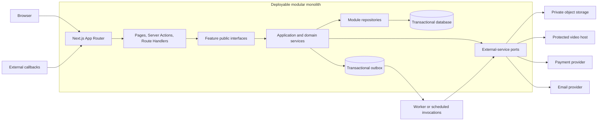

# LMS architecture overview

## Purpose and decision status

This document defines the implementation boundaries for the LMS described in
[product requirements](../product/requirements.md), [delivery scope](../product/mvp.md),
and the [open-question register](../product/open-questions.md). It is the default
architecture for application work; it does not resolve open product policy.

The following labels distinguish established decisions from design proposals:

- **Approved baseline** — required by the repository instructions or
  [ADR-0001](../decisions/0001-modular-monolith.md).
- **Proposed technical choice** — recommended here, but requiring confirmation or
  a focused ADR before implementation makes it expensive to change.
- **Product decision required** — blocked by a question in
  `docs/product/open-questions.md`; engineers must not choose the answer.

Approved baseline:

- a TypeScript, Next.js App Router application;
- a feature-based modular monolith deployed as one application;
- domain code in `src/features`, route entry points in `src/app`, shared database
  plumbing in `src/db`, generic UI in `src/components/ui`, and small technical
  utilities in `src/lib`;
- the seven modules and their contracts described in
  [modules.md](./modules.md).

This architecture deliberately does not select a database product, ORM,
authentication library, payment provider, object store, protected-video provider,
email provider, job runtime, or hosting platform. Those choices must follow an
approved requirement and should be recorded separately.

The product documents mark MVP server-side support expiration and immediate access
revocation after confirmed refund as scope corrections pending product-owner
approval. This architecture describes the secure target workflows but does not
convert their MVP release placement into an approved product decision.

## Architectural goals

The foundation must:

1. protect payments, enrollments, private media, student work, and personal data
   at every server entry point;
2. keep business rules testable without React or HTTP;
3. let multiple coding agents change separate modules without relying on private
   implementation details;
4. make payment, refund, enrollment, and certificate operations auditable and
   safe to retry;
5. preserve the MVP boundary while leaving explicit seams for approved later
   phases;
6. stay deployable as one application and avoid infrastructure that the product
   does not yet require.

Non-goals are microservices, a generic enterprise framework, a repository per
database table, a universal event bus, and abstractions created only for possible
future reuse.

## System shape



The database, outbox, and worker boxes describe logical responsibilities, not
selected products. A relational transactional primary store and a database-backed
outbox are **proposed technical choices** because the core workflows span several
owned records and must be atomic and retryable. They require confirmation together
with the persistence and job-runtime decisions.

## Feature-based modular monolith

Each feature owns its business concepts, state transitions, persistence queries,
server-only application services, and feature-specific UI. A module exposes a
small public surface from `src/features/<feature>/index.ts`; code outside the
module must not import its `internal`, `data`, or implementation files.

The monolith shares a process and, initially, a database so critical workflows can
use local calls and database transactions. Sharing a deployment does not permit
sharing arbitrary tables or importing internal code. Ownership is a code rule:
only the owning module writes its records. Cross-module reads and commands go
through its exported interface.

`src/lib` is not a miscellaneous business layer. It may contain narrowly scoped
technical helpers such as clocks, identifiers, result types, logging adapters, and
cryptographic primitives. `src/db` owns connection, transaction, migration, and
schema infrastructure, not domain queries or business rules. Generic visual
primitives belong in `src/components/ui`; feature components remain with their
feature.

For detailed module ownership and dependency rules, see
[modules.md](./modules.md).

## Next.js App Router boundary

The repository uses Next.js 16.4 with Cache Components and partial prefetching
enabled. The implementation must follow the installed guides under
`node_modules/next/dist/docs/`, not assumptions from earlier Next.js versions.

### `src/app` responsibilities

`src/app` is the delivery layer. It owns URL structure, layouts, route metadata,
loading and error boundaries, request/response translation, and composition of
feature UI. Pages, layouts, Route Handlers, and Server Actions remain thin:

- parse framework inputs;
- invoke an exported feature query or command;
- map typed outcomes to UI, redirect, or HTTP response;
- never contain pricing, entitlement, completion, refund, or authorization rules;
- never query another module's tables directly.

Server Components should call server-side feature queries directly. They should
not make an HTTP request to this application's own Route Handler, which adds an
unnecessary network boundary and can fail during build-time rendering.

### Server Components

Server Components are the default for pages and non-interactive composition. They
may read protected data through authorized feature query functions and pass only
minimal serializable view data to Client Components. They must not pass database
rows, secrets, provider tokens, internal status metadata, or unnecessary personal
data to the client.

With Cache Components enabled, session and request-dependent reads must stay
behind an appropriate `Suspense` boundary. Shared caching must not contain
user-private or authorization-dependent results unless the cache key and scope
make that isolation explicit. Authorization is always re-evaluated at the protected
data or mutation boundary; a cached UI decision is not authorization.

### Client Components

Client Components are opt-in interaction islands for browser APIs, local state,
event handlers, upload progress, media controls, or other interactivity. Keep the
`"use client"` boundary as low as practical. Client Components may request an
operation but may never decide roles, ownership, price, entitlement, progress,
certificate eligibility, or refund effects.

### Server Actions

Use Server Actions for first-party UI mutations whose caller is this Next.js
application, such as submitting a form or recording a lesson-progress update.
Every action is treated as a reachable server endpoint and must:

1. authenticate the actor;
2. validate and normalize untrusted input;
3. invoke a feature command that performs resource authorization and business
   validation;
4. return a narrow, serializable result;
5. invalidate or refresh only after the transaction commits.

Do not use a Server Action for payment webhooks, file delivery, provider
callbacks, public integrations, or an API contract consumed outside the rendered
application.

### Route Handlers (API routes)

Use `route.ts` Route Handlers only when an HTTP boundary is required: provider
webhooks, authentication callbacks, signed upload/download or playback grants,
health checks, or an explicitly supported external API. Handlers validate method,
content type, size, signature, and input before delegating to a feature service.
They do not implement domain rules.

Payment and other webhooks must verify the raw provider payload as required by the
selected provider, store a deduplication record, and acknowledge only according to
the provider's retry contract. Browser return URLs are not proof of payment.

Next.js Proxy, if introduced, may perform cheap redirects or optimistic session
checks. It is never the only authorization layer; the feature service closest to
the data makes the authoritative decision.

## Application, domain, validation, and persistence boundaries

The intended call chain is:

```text
page / Server Action / Route Handler
  -> input schema
  -> feature command or query
  -> authentication + resource authorization
  -> domain policy / state transition
  -> owned repository within transaction
  -> narrow result / DTO
```

### Validation

Validation occurs in two stages:

- **Boundary validation** checks shape, type, length, file metadata, content type,
  and syntactic constraints for all request, action, callback, and job inputs.
- **Business validation** checks current state and policy, such as price caps,
  publication status, support activity, allowed assignment transitions, refund
  eligibility, or certificate eligibility.

The same command service performs business validation regardless of whether it is
called by a Server Action, Route Handler, administration UI, or job. The validation
library is deliberately not selected yet.

### Services

Application services describe use cases and transaction boundaries. Domain
functions model business decisions and should be pure where practical. Services
may call another module only through that module's public interface. Do not create
a service class for a simple function solely to satisfy a pattern.

### Repositories

Repositories belong to the module whose data they access. They expose use-case
operations, not generic CRUD, and accept an explicit transaction context for
multi-record workflows. A repository returns domain records or narrow internal
projections, never an ORM query builder to callers.

Only server-only modules may import the database client. Add a server-only guard
to persistence and provider-adapter entry points once the implementation begins.
React components and browser bundles never import repositories.

### Public module contracts

A public contract should express intent and avoid leaking persistence models:

```ts
// src/features/learning/index.ts
export type GrantEnrollment = Readonly<{
  studentId: string;
  productId: string;
  sourceOrderLineId: string;
}>;

export interface LearningCommands {
  grantEnrollment(input: GrantEnrollment, context: TransactionContext): Promise<void>;
  revokeEnrollmentByOrderLine(
    orderLineId: string,
    context: TransactionContext,
  ): Promise<void>;
}
```

`TransactionContext` above is a small shared database primitive, not permission to
issue arbitrary cross-module queries. The exact API depends on the selected
persistence tool.

## Database access and consistency

The following rules apply independently of the selected database library:

- use opaque identifiers and explicit foreign keys between module-owned records;
- enforce uniqueness and invariants in the database where possible;
- represent money as integer minor units plus currency, never floating point;
- snapshot mutable commercial facts such as product title, price, discount,
  consent version, and attribution on the order records that require history;
- store timestamps in UTC and inject a clock into time-sensitive domain logic;
- use explicit transactions for state transitions spanning related records;
- avoid soft deletion as a universal default; use explicit lifecycle states where
  retention and audit behavior matter;
- migrations are additive and backward compatible across a rolling deployment;
- production data fixes use reviewed, auditable operations rather than ad hoc UI
  or direct database edits.

Cross-module joins may be used inside read-only reporting projections when an
owner cannot provide a practical query contract. Those projections are not a back
door for writes or business decisions, and their definitions must document each
source owner. Operational services use module APIs, not report projections.

Database row-level security may be defense in depth if the selected platform
supports it, but it does not replace application authorization.

## Authentication and authorization

Authentication establishes a session and a stable user identifier. Authorization
is deny-by-default and evaluates both role capability and resource relationship.
The authentication provider and session strategy are **proposed-decision gaps**;
OQ-032 also blocks the guest-checkout account matching policy.

Every protected command or query constructs or accepts a narrow actor context:

```ts
type ActorContext = Readonly<{
  userId: string;
  roleIds: readonly RoleId[];
  sessionId: string;
}>;
```

Role presence alone is insufficient. Examples of required resource checks include:

- a student has an active enrollment for the requested lesson or material;
- a submission belongs to that student, assigned curator, or authorized
  administrator;
- a curator is assigned to the relevant enrollment/course and may perform the
  requested transition while support policy permits it;
- a manager sees only attributed sales or assigned leads;
- an administrator has the specific administrative capability and the action is
  audited.

Do not accept roles, ownership IDs, prices, completion state, or access expiry from
the client. Blocking an account invalidates protected use without deleting records;
its exact residual capabilities remain a product decision under OQ-016.

Signed object-storage and video-playback URLs are issued only after the same
resource authorization checks. They are short-lived capabilities, not substitutes
for entitlements.

## Errors, transactions, retries, and idempotency

### Error handling

Expected domain outcomes use explicit typed results or known domain errors, for
example `NOT_AUTHENTICATED`, `NOT_AUTHORIZED`, `INVALID_TRANSITION`,
`SUPPORT_EXPIRED`, or `CONFLICT`. Entry points translate them consistently to form
feedback, `notFound`, redirects, or HTTP status codes. Unexpected errors are logged
with a correlation ID and shown through the nearest App Router error boundary.

Responses and logs must not expose stack traces, secrets, signed URLs, raw payment
payloads, student media, or unnecessary personal data. A centralized error
catalog is useful only for errors actually shared across entry points; feature-only
errors stay in the feature.

### Transaction boundaries

A critical state transition commits all authoritative database changes together.
Examples include payment confirmation plus order state plus enrollment, and refund
confirmation plus access revocation. External calls do not run inside a long
database transaction. Instead, commit the business change and an outbox message in
one transaction, then deliver external side effects asynchronously.

### Idempotency

All externally retried or user-repeatable critical commands carry a stable
idempotency identity. The database enforces uniqueness for provider event IDs,
payment references, order-fulfillment facts, enrollment source order lines,
refund references, certificate eligibility/issuance keys, and notification jobs as
appropriate.

The repeat path returns the already-recorded outcome or performs a safe no-op; it
does not duplicate enrollment, refund effects, certificate numbers, emails, or
financial accruals. Idempotency records and domain writes share a transaction.

A database-backed transactional outbox with retry count, next-attempt time, and
dead-letter/attention state is a **proposed technical choice**. It satisfies the
documented durability need without requiring a message broker. The runtime that
drains it remains undecided.

## Files, video, and external integrations

### Private files

Course materials and student submissions use private object storage. The browser
uploads large media directly through a narrowly scoped, short-lived upload grant
after server authorization. The server records an expected file object before
granting upload and finalizes it only after verifying key, size, type, ownership,
and processing result. Downloads use short-lived authorized grants; permanent
public object URLs are prohibited for protected content.

Quarantine, scanning, normalization, failed-upload recovery, allowed media, limits,
and retention are blocked by OQ-004, OQ-043, OQ-044, and OQ-008. The architecture
provides states such as pending, ready, rejected, and failed without choosing those
policies.

### Protected video

Course video is delivered by a dedicated protected-video provider, not through the
Next.js server. The Learning module verifies access and asks the provider adapter
for a short-lived playback capability. Playback progress reported by the client is
untrusted input and is validated before it affects progress. Provider choice and
the authoritative viewed/completed rule are blocked by OQ-002 and OQ-021.

### Integration adapters

Each integration is hidden behind a small port owned by the module that needs it:
Commerce owns payment, Learning owns protected playback, Assignments owns submission
media processing, Certificates owns document generation, and Notifications owns
delivery channels. SDK types do not cross the adapter boundary. Provider webhook
payloads are retained or normalized according to approved security and retention
rules, and mapped to internal commands only after signature validation.

## Testing strategy

Tests follow risk and boundary, not a fixed pyramid quota:

- **Domain unit tests** cover prices, entitlement states, support windows,
  assignment transitions, completion, refund effects, and authorization matrices.
- **Application tests** exercise services with real validation and controlled
  repository/integration doubles, including rollback and idempotent replay.
- **Repository integration tests** run against the selected database engine and
  verify constraints, locking/concurrency behavior, transaction rollback, and
  migrations.
- **Boundary tests** call Server Actions and Route Handlers with malformed,
  unauthenticated, unauthorized, duplicate, oversized, and forged inputs.
- **Contract tests** replay representative signed provider callbacks and validate
  adapter mapping without depending on production systems.
- **End-to-end tests** cover purchase-to-certificate, failed and duplicate payment,
  direct protected-resource access, mobile homework submission, support expiry,
  and refund access revocation.
- **Operational tests** exercise outbox retries, backup restoration, deployment
  rollback, and production smoke checks before the relevant release.

Use factories with invented data. Never copy real student, payment, or media data
into fixtures. Tests that depend on an unresolved product answer remain pending
with the open-question ID; they must not encode a guess.

## Deployment and operations

The application, database migrations, and background processing must be versioned
and observable as one release even when the hosting platform runs them as separate
process types. Deployment must support:

- HTTPS and secret storage outside source control;
- separate development, test, staging, and production configuration;
- migrations that are safe before both old and new application revisions;
- health/readiness checks and a production smoke test;
- structured, redacted logs with request, job, order, and provider-event
  correlation IDs;
- metrics and alerts for payment callbacks, enrollment failures, upload/media
  processing, authorization denial anomalies, email delivery, scheduled work, and
  outbox backlog;
- tested database and private-media backups with approved recovery objectives;
- a rollback runbook that does not reverse an already-applied destructive schema
  change;
- explicit runtime declarations when code depends on Node.js-only provider SDKs.

The hosting platform, job invocation mechanism, observability provider, recovery
objectives, and alert thresholds remain decisions. OQ-078 and OQ-080 block the
operational acceptance criteria.

## Maintaining boundaries with multiple coding agents

Changes should be partitioned by module and exposed contract. An agent working in
one feature may add to another feature's public contract only as a deliberate,
reviewed part of the same change; it must not bypass the contract by importing an
internal path or writing another module's tables.

Each implementation slice should:

1. name the product requirement and unresolved questions it touches;
2. change one module owner at a time where practical;
3. keep files focused on one responsibility;
4. add contract and business-rule tests with the behavior;
5. update these documents or a focused ADR when a boundary changes.

Import restrictions should initially be documented and reviewed. A lint rule may
enforce them when concrete violations justify that maintenance cost; no new lint
plugin is approved by this document.

## Decisions required before implementation

The full product register remains authoritative. These architectural decisions
must be resolved before their dependent foundation work:

| Decision | Why architecture needs it | Product dependencies |
| --- | --- | --- |
| Primary database and persistence/migration tool | Defines transaction API, constraints, tests, and deployment | OQ-078, OQ-081 |
| Authentication library/provider and session model | Defines account/session storage, verification, blocking, and multi-role actor context | OQ-013, OQ-016, OQ-032 |
| Payment provider, merchant entity, authoritative event states, and currency scope | Defines checkout adapter, webhook verification, idempotency keys, and order state machine | OQ-001, OQ-029–OQ-032, OQ-037 |
| Enrollment/support ownership and clock policy | Defines the entitlement aggregate and every time-based authorization check | OQ-003, OQ-048–OQ-050 |
| Lesson completion and sequential-unlock policy | Defines progress storage, authorization, and certificate inputs | OQ-021, OQ-042 |
| Homework media policy and storage/processing provider | Defines upload contract, states, validation, security, and retry behavior | OQ-004, OQ-043, OQ-044 |
| Protected-video provider and contracted capabilities | Defines playback authorization and media metadata | OQ-002, OQ-084 |
| Background job/outbox execution mechanism | Defines durable callback follow-up, reminders, email, media processing, and operations | OQ-069, OQ-080 |
| Email provider and delivery policy | Defines sender authentication, callback mapping, retry, localization, and operational support | OQ-006, OQ-069, OQ-080 |
| Audit scope, retention, privacy, and recovery objectives | Defines immutable evidence, deletion exceptions, storage lifecycle, and backup design | OQ-008, OQ-079, OQ-081–OQ-083 |
| Certificate identity/template/reissue rules | Defines eligibility snapshot and immutable issuance model | OQ-051–OQ-057 |
| MVP operational administration path | Determines which safe commands and audited tools must exist at launch | OQ-010, OQ-085 |
| Product-owner approval of the two pending MVP scope corrections | Determines MVP acceptance coverage for support expiration and refund access revocation | OQ-003, OQ-037, OQ-048, OQ-049, OQ-085 |

Provider selections and technical tools should be recorded in focused ADRs.
Approved product answers must first be recorded in
`docs/product/open-questions.md` using its decision template, then reflected in the
requirements, scope, state machines, and tests.
