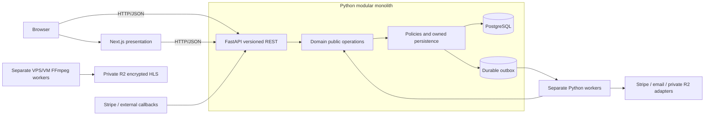

# LMS architecture overview

## Current implementation snapshot · 2026-11-06

The frontend is implemented; Python has a [database migration foundation](database-migrations.md), not a running application service. Eight App Router page templates cover `/`, two catalogs, two dynamic detail families, `/cart`, `/checkout` and `/preview/components`. Root layout composes CatalogProvider, CartProvider, PublicHeader, PublicMotion and PublicSiteFooter. Catalog leaves return null under their persistent group layout; both detail kinds share ProductRoute/DetailPage. Existing frontend owners and UI remain in place.

Presentation owners are `home`, `catalog`, `course-detail`, `public-shell`, `identity`, `commerce`, `component-preview`. Generic UI remains Button/Link, form controls and SectionHeading; PageContainer belongs to public-shell. Styles/fonts and numbered sections are unchanged. `TEST_PREVIEW=true` alone enables browser-local fixtures. False/missing returns unavailable, not invented inventory; auth and purchases remain unavailable.

The former `src/server/catalog/{index,contracts,policy}.ts` contained a disconnected read adapter, DTO types and pure read/purchase checks, with no database. They are retired. Existing disconnected UI handling and temporary view types remain in `src/features/catalog/catalog-source.ts` and `catalog-view-types.ts`; defensive SEO exclusion is in `src/lib/seo/product-indexability.ts`. These are not an authoritative backend or new mock API. See [migration evidence](../qa/python-backend-migration-2026-11-03.md).

`backend/` has Python 3.12/uv, SQLAlchemy/Psycopg, the preserved Alembic baseline plus reviewed successors, 28 owner-local tables, bounded sync units of work, no-op seed, recovery utilities, generated diagrams and configured checks. See the [physical schema contract](database/schema-contract.md). Services, endpoints, auth and workers remain absent. Existing empty `src/db` is a retired placeholder; it must not gain authoritative database access. Empty `src/app/api` is retained only for a future justified thin transport boundary. Empty legacy frontend feature folders are not implemented domains. `src/lib` contains actual frontend environment/SEO utilities.

[Frontend registries](frontend-pages.md) locate real owners/consumers. The dated [LAND01 audit](../qa/LAND01-public-site-audit-2026-11-02.md) and LAND03/04 evidence remain historical, not current backend implementation or visual approval.

## Purpose and decision status

For authentication, sessions, manual administrator management, claiming and
enrollment lifecycle, read [PD-014's identity/access policy](identity-access-policy.md)
and the [permission matrix](../product/permission-matrix.md). PD-013 supersedes older
activation/duration/refund/manager/retention wording; PD-014 fixes product lifetimes
without selecting an authentication provider. Older admin review/inspection
descriptions are qualified by the selected Deny cells and unresolved OQ-096.
Resource Ownership & Security Validation remains the next task, not completed here.

This document defines the implementation boundaries for the LMS described in
[product requirements](../product/requirements.md), [delivery scope](../product/mvp.md),
[approved product decisions](../product/decisions.md), and the
[open-question register](../product/open-questions.md). It is the default
architecture for application work; it does not resolve open product policy.

The following labels distinguish established decisions from design proposals:

- **Approved baseline** — required by the repository instructions or
  [ADR-0003](../decisions/0003-python-backend-architecture.md), preserving the domain/frontend principles from ADR-0001/0002.
- **Proposed technical choice** — recommended here, but requiring confirmation or
  a focused ADR before implementation makes it expensive to change.
- **Product decision required** — blocked by a question in
  `docs/product/open-questions.md`; engineers must not choose the answer.

Approved baseline:

- one repository with independently deployable Next.js 16 / React / TypeScript / Tailwind frontend and Python FastAPI backend;
- one Python modular monolith, with seven domain owners under `backend/app/modules`, not independently deployed domain services;
- Pydantic v2 validation, SQLAlchemy 2 persistence, Alembic migrations, PostgreSQL primary database and Neon as intended hosting;
- uv, pytest, Ruff and a configured static checker; mypy is recommended, with exact Python/dependency versions and driver selected at initialization;
- frontend presentation in `src/features`, thin routes in `src/app`, generic UI in `src/components/ui`, small frontend technical utilities in `src/lib`;
- versioned HTTP/JSON REST and generated OpenAPI contracts between runtimes; no frontend access to authoritative business tables;
- separate Python workers for durable background work and the approved separate FFmpeg runtime;
- the seven modules and detailed contracts in [modules.md](modules.md).

PD-002 selects Stripe embedded Payment Element and the existing US-entity account,
with USD pricing/charges/payouts and eligible cards, Apple Pay, Google Pay and Klarna
for one-time purchases. Subscriptions are excluded from all planned phases.
PD-003 selects self-managed encrypted HLS, private Cloudflare R2 and separate
VPS/VM FFmpeg workers. Authentication, email, job-runtime technology,
application hosting, and video-worker provider/capacity remain implementation decisions.
The separate media runtime does not change the seven domain-module boundaries.

PD-004 approves server-enforced enrollment support/access deadlines and access
revocation on refunds/closure, preserving historical learning records subject to
PD-007 retention. OQ-036/OQ-037 and OQ-048/OQ-049 still block unresolved refund
and post-expiration details; the approvals do not settle those questions.

## Architectural goals

The foundation must:

1. protect payments, enrollments, private media, student work, and personal data
   at every server entry point;
2. keep business rules testable without React or HTTP;
3. let multiple coding agents change separate modules without relying on private
   implementation details;
4. make payment, refund, enrollment, and certificate operations auditable and
   safe to retry;
5. preserve the MVP boundary while leaving explicit seams for approved later
   phases;
6. keep one coherent Python backend with independently deployable frontend and
   avoid infrastructure that the product does not require.

Non-goals are microservices, a generic enterprise framework, a repository per
database table, a universal event bus, and abstractions created only for possible
future reuse.

## System shape



Browser-to-API transport may use same-origin ingress or a justified thin Next.js BFF; topology/session details remain recommendations in the [integration contract](frontend-backend-integration.md). PostgreSQL is selected and Neon is intended hosting. Durable processing is required; a PostgreSQL transactional outbox is the proposed mechanism, not an implemented table or selected job executor.

## Feature-based modular monolith

Frontend features retain page/section/component composition and UI state. Python domains own rules, resource authorization, use cases, state and persistence under `backend/app/modules`. Each exposes narrow local public commands/queries; callers do not import private ORM models, repositories or provider adapters. Cross-domain calls remain in-process with explicit transactions; only the owning domain writes its records. The frontend crosses HTTP, not Python imports or shared database access.

`backend/app/core` contains small technical configuration/logging/clock helpers; `backend/app/db` owns engine/session/transaction plumbing. ORM mappings belong to domain owners; Alembic revisions live under `backend/alembic/versions`. `backend/app/api` composes thin versioned routers; `backend/app/jobs` wires execution and does not own business policy. No folder is an eighth domain. `src/lib` remains frontend technical/SEO helpers, never a hidden business layer.

## Next.js App Router boundary

The repository uses installed Next.js 16.4.3 with Cache Components and partial prefetching. Read `node_modules/next/dist/docs/` before affected work. Framework permission to query a database does not override this project's HTTP-only authoritative-data boundary.

### Routes and Server Components

`src/app` owns URLs/layouts, metadata, loading/error boundaries and feature composition. Server Components use future generated API contracts to request authorized FastAPI projections, map outcomes and pass minimal serializable view data to Client Components. They do not issue direct SQL, implement policy, or call their own Route Handler as an unnecessary intermediary. Internal service origins, session credentials and private diagnostics remain server-only.

Session-dependent reads require the appropriate request/Suspense boundary. Never share-cache private or authorization-dependent results across users. Public caching must account for publication/price invalidation across list/detail/home/SEO consumers. The backend always re-authorizes protected operations; cached UI decisions confer no rights. Outage, empty, missing and denied outcomes stay distinct.

### Client Components

Keep interaction islands small and preserve existing feature owners. Client code may request operations but never decides roles, ownership, authoritative price, entitlement, progress/completion, certificate eligibility or refund effects. Preview fixtures remain explicit browser-local demonstration only. Generate API types/client from OpenAPI during real integration, rather than duplicating Python schemas by hand.

### Optional Server Actions and Route Handlers

Actions/handlers may forward validated requests, agreed session credentials, safe responses and presentation composition when there is a concrete need. They cannot become authoritative authentication, payment, catalog or learning layers. `src/app/api/.gitkeep` is intentionally empty; same-origin ingress may remove the need for a BFF. Domain operations, Stripe webhooks, upload authorization and durable jobs belong to Python.

Treat every action/handler as reachable; enforce transport limits/CSRF where appropriate and never trust identity headers supplied by a browser. Backend resource authorization remains mandatory. Forward only allowed headers to a fixed backend origin. Refresh UI only after confirmed backend success; a timed-out mutation may have committed and needs reconciliation. Next.js Proxy may make optimistic redirects, never final authorization decisions.

## Application, domain, validation and persistence boundaries

The intended call chain is:

```text
Next.js SSR / browser -> versioned FastAPI HTTP API
  -> Pydantic boundary validation + trusted actor context
  -> owning Python operation + resource authorization
  -> business policy / state transition
  -> owned SQLAlchemy persistence in an explicit transaction
  -> safe response schema -> generated TypeScript contract -> UI view mapping
```

Workers and provider callbacks invoke the same domain operations through their respective validated entry points. Pydantic v2 validates untrusted inputs; syntactic validation is separate from current-state/business validation. Response schemas expose only approved fields, not ORM models or secrets. Pure policies should remain independent of FastAPI and SQLAlchemy where practical.

Use `router.py` for HTTP mapping, `schemas.py` for Pydantic transport models, `models.py` for owned SQLAlchemy mappings, `service.py` for use cases/transaction coordination and `policies.py` for rules. Optional focused persistence adapters separate nontrivial queries when useful. These are responsibility conventions, not mandatory layers; only owner-local models and technical database plumbing are implemented. See [backend README](../../backend/README.md) and mandatory [backend instructions](../../backend/AGENTS.md).

Application services name the workflow/transaction owner; participating domain commands must not independently commit. Use narrow typed inputs/results instead of ORM objects or query builders across domains. Public Python contracts may accept an explicit transaction context for atomic operations such as enrollment grant/revocation; that context does not permit cross-domain table writes. The exact concrete API follows the selected driver/session design at initialization.

## Database access and consistency

PostgreSQL, SQLAlchemy 2 and Alembic are selected; driver/pool/session configuration remains to be implemented. The following rules apply:

- use opaque identifiers and explicit foreign keys between module-owned records;
- enforce uniqueness and invariants in the database where possible;
- represent money as integer minor units plus currency, never floating point;
- snapshot mutable commercial facts such as product title, price, discount,
  consent version, and attribution on the order records that require history;
- store timestamps in UTC and inject a clock into time-sensitive domain logic;
- use explicit transactions for state transitions spanning related records;
- avoid soft deletion as a universal default; use explicit lifecycle states where
  retention and audit behavior matter;
- migrations are additive and backward compatible across a rolling deployment;
- production data fixes use reviewed, auditable operations rather than ad hoc UI
  or direct database edits.

Cross-module joins may be used inside read-only reporting projections when an
owner cannot provide a practical query contract. Those projections are not a back
door for writes or business decisions, and their definitions must document each
source owner. Operational services use module APIs, not report projections.

Database row-level security may be defense in depth if the selected platform
supports it, but it does not replace application authorization.

## Authentication and authorization

Authentication establishes a session and a stable user identifier. Authorization
is deny-by-default and evaluates both role capability and resource relationship.
The authentication provider and session strategy are **proposed-decision gaps**; the [integration contract](frontend-backend-integration.md) recommends one-origin ingress and Identity-owned revocable HttpOnly cookie sessions, without initializing them.
OQ-032 also blocks the guest-checkout account matching policy.

Every protected command or query constructs or accepts a narrow actor context.
The trusted Python actor contract carries a stable user identifier, verified capabilities/roles and session reference. It is constructed by Identity, never from unverified browser claims. Its concrete typed representation is an implementation detail; HTTP response schemas expose only needed fields.

Role presence alone is insufficient. Examples of required resource checks include:

- a student has an active enrollment for the requested lesson or material;
- a submission belongs to that student, assigned curator, or authorized
  administrator;
- a curator is assigned to the relevant enrollment/course and may perform the
  requested transition while support policy permits it;
- an authorized referral partner sees only permitted own attribution; lead/contact access requires a separate capability;
- an administrator has the specific administrative capability and the action is
  audited.

Do not accept roles, ownership IDs, prices, completion state, or access expiry from
the client. Blocking an account invalidates protected use without deleting records;
its exact residual capabilities remain a product decision under OQ-016.

Signed object-storage and video-playback URLs are issued only after the same
resource authorization checks. They are short-lived capabilities, not substitutes
for entitlements.

## Errors, transactions, retries, and idempotency

### Error handling

Expected domain outcomes use explicit typed results or known domain errors, for
example `NOT_AUTHENTICATED`, `NOT_AUTHORIZED`, `INVALID_TRANSITION`,
`SUPPORT_EXPIRED`, or `CONFLICT`. FastAPI entry points translate them into the shared sanitized HTTP error contract. Next.js maps those outcomes to form feedback, `notFound`, redirects or error boundaries. Unknown failures retain a safe correlation reference, never raw backend details.

**Approved product decision PD-001:** [failure messages and traceable logging](../product/decisions.md#pd-001--clear-failure-messages-and-traceable-diagnostics).
Each failed operation must have two appropriately separated representations:

1. **User-facing message:** use clear, nontechnical wording appropriate to the
   interface locale (Russian first for MVP). Explain what happened in familiar
   language, whether the action succeeded when that can be established, and
   the next safe step. Never expose HTTP codes, database errors, webhook terms,
   stack traces, or provider internals. Provide a safe support reference code for
   unexpected problems. For an uncertain payment state, do not claim that funds
   were or were not charged; advise the user not to repeat payment until the
   status is verified.
2. **Developer/operator diagnostic:** create a structured, actionable, and
   traceable event recording a stable internal error code, severity, UTC time,
   module/operation, sanitized resource IDs, correlation/request/job ID,
   known outcome, retry eligibility and attempt, and root-cause context when
   known. Propagate correlation across provider callbacks, outbox jobs, and
   retries. Record expected validation or access failures at an appropriate
   severity rather than treating every such event as a production emergency.

Examples of user-facing Russian copy:

- Upload interrupted: "Не удалось загрузить файл. Проверьте подключение и
  попробуйте ещё раз. Уже отправленные файлы останутся, если они были сохранены."
  Only mention saved files when the application has confirmed they were saved.
- Video temporarily unavailable: "Не удалось открыть урок. Попробуйте немного
  позже. Если проблема повторится, обратитесь в поддержку и укажите код ошибки."
- Payment status unknown: "Проверяем статус оплаты. Не оплачивайте заказ повторно,
  пока статус не обновится. Если это занимает слишком долго, обратитесь в поддержку."

Responses and diagnostics must not expose secrets, signed URLs, raw payment
payloads, student media, personal contacts, or unnecessary personal data.
Detailed logs are restricted to authorized operators. Failure tests must assert
both the useful user-visible result and a searchable, privacy-safe diagnostic
record. PD-007 sets 30-day retention for technical errors and routine administrator
activity; critical audit records follow legally required periods. Legal retention
verification, exact audit scope, alert thresholds and escalation remain under
residual OQ-008, OQ-079 and OQ-080. A centralized error catalog
is useful only for errors actually shared across entry points; feature-only
errors stay in the feature.

### Transaction boundaries

A critical state transition commits all authoritative database changes together.
Examples include payment confirmation plus order state plus enrollment, and refund
confirmation plus access revocation. External calls do not run inside a long
database transaction. Instead, commit the business change and an outbox message in
one transaction, then deliver external side effects asynchronously.

### Idempotency

All externally retried or user-repeatable critical commands carry a stable
idempotency identity. The database enforces uniqueness for provider event IDs,
payment references, order-fulfillment facts, enrollment source order lines,
refund references, certificate eligibility/issuance keys, and notification jobs as
appropriate.

The repeat path returns the already-recorded outcome or performs a safe no-op; it
does not duplicate enrollment, refund effects, certificate numbers, emails, or
financial accruals. Idempotency records and domain writes share a transaction.

A database-backed transactional outbox with retry count, next-attempt time, and
dead-letter/attention state is a **proposed technical choice**. It satisfies the
documented durability need without requiring a message broker. The runtime that
drains it remains undecided.

## Files, video, and external integrations

### Private files

Course materials and student submissions use private object storage. The browser
uploads large media directly through a narrowly scoped, short-lived upload grant
after server authorization. The server records an expected file object before
granting upload and finalizes it only after verifying key, size, type, ownership,
and processing result. Downloads use short-lived authorized grants; permanent
public object URLs are prohibited for protected content.

PD-005 requires resumable homework uploads, 1 GB per file and combined original
submission size, no fixed count cap, supported JPEG/PNG/HEIC/WebP/MP4/MOV/WebM
normalization, image auto-orientation/high-quality compression to maximum 2560px,
and H.264/AAC MP4 video to maximum 1080p. Generate thumbnails/playable previews;
allow preview/removal/replacement without corrupting submission history. Preserve
originals until processing succeeds. Authorize the submitting student, assigned
curator and administrators; use short-lived signed delivery and PD-001 safe retries.
Quarantine/scanning specifics remain engineering work; OQ-043/OQ-044 remain
unresolved. PD-007 governs retention, including outstanding reviews and legal
exceptions; it does not authorize unconditional deletion at nominal expiry.

### Protected video

PD-003 replaces external hosting with self-managed encrypted adaptive HLS in
private Cloudflare R2, processed by FFmpeg workers on a separate VPS/VM. Supply
1080p maximum plus 720p and 480p variants. Learning enforces enrollment authorization
and short-lived playback access; segments and encryption keys remain protected.
The MVP player includes a moving student-specific identifier and selectable RU/EN
audio/subtitles where available. DRM is after MVP; screen-capture blocking is not
guaranteed. No identifier format or key-management algorithm is implied.

Trainers and administrators upload resumable MP4/MOV/WebM with supported codecs,
maximum 20 GB and 4 hours per video; only administrators publish. Catalog owns
publication and must reject incomplete processing while preserving the previous
published version. Use a persistent queue, initially one concurrent job, three
automatic retries and manual recovery, with PD-001 errors/diagnostics.

VIDEO001 follows up completed INF03 and must specify implementation, encryption-key management, recovery, supported-
browser testing, operational verification and worker capacity/provider. Validate
the $50–$100/month target through capacity testing, not an assumed cost guarantee.
PD-004/PD-007 govern access and retention. Client progress remains untrusted and
the authoritative lesson-completion rule remains unresolved under OQ-021.

### Integration adapters

Each integration is hidden behind a small port owned by the module that needs it:
Commerce owns payment, Learning owns protected playback, Assignments owns submission
media processing, Certificates owns document generation, and Notifications owns
delivery channels. SDK types do not cross the adapter boundary. Provider webhook
payloads are retained or normalized according to approved security and retention
rules, and mapped to internal commands only after signature validation.

## Approved MVP operations and workflow constraints

PD-008 requires server-calculated 48 counted weekday-hour review deadlines using
the assigned curator timezone captured per submission/resubmission, including
public holidays and excluding weekends. Viewers see local deadlines. Durable,
retry-safe notifications occur immediately, at 24/12/6/1 remaining hours and overdue;
admin overdue notifications persist and are auditable. Keep overdue work queued
and protect concurrent actions. The older admin-review grant conflicts with
PD-014 matrix Deny; OQ-096 must reconcile the workflow without bypassing selections.

PD-009 makes complete category/course authoring and content/price approval plus
independent visibility/sale/archive controls MVP. Validate readiness before
publication and preserve existing entitlements through sales pauses/archiving.
PD-010 requires essential admin-dashboard operations without routine developer
intervention and manual administrator evidence review/issuance of every certificate
after automatic eligibility calculation. PD-013 supersedes its refund rule:
administration handles execution for requests within 24 hours of payment AND an
unstarted course; residual legal/execution/boundary details remain OQ-037/OQ-093.
Infrastructure recovery/server management stays outside the admin dashboard.

Admin monitoring includes courses, progress, submissions, review history/deadlines,
course conversations and student-request statuses. Provide persistent admin
notifications and a separate admin-restricted log-viewer route with date/severity/
operation/resource/reference-ID filtering and readable, privacy-safe diagnostics;
no literal route is chosen here. Sensitive admin actions require an explanatory
confirmation popup, explicit confirmation, recent password reauthentication (PD-014), server authorization and audit of actor,
action, resource, timestamp and outcome. Account/role workflows remain separately
authorized; no permission is inferred. Module ownership remains in [modules.md](./modules.md).

## Testing strategy

Tests follow risk and boundary, not a fixed pyramid quota:

- **Domain unit tests** cover prices, entitlement states, support windows,
  assignment transitions, completion, refund effects, and authorization matrices.
- **Application tests** exercise services with real validation and controlled
  repository/integration doubles, including rollback and idempotent replay.
- **Repository integration tests** run against isolated PostgreSQL and
  verify constraints, locking/concurrency behavior, transaction rollback, and
  migrations.
- **Boundary tests** call FastAPI endpoints and any justified thin frontend adapters with malformed,
  unauthenticated, unauthorized, duplicate, oversized, and forged inputs.
- **Contract tests** replay representative signed provider callbacks and validate
  adapter mapping without depending on production systems.
- **End-to-end tests** cover purchase-to-certificate, failed and duplicate payment,
  direct protected-resource access, mobile homework submission, support expiry,
  and refund access revocation.
- **Operational tests** exercise outbox retries, backup restoration, deployment
  rollback, and production smoke checks before the relevant release.

Use factories with invented data. Never copy real student, payment, or media data
into fixtures. Tests that depend on an unresolved product answer remain pending
with the open-question ID; they must not encode a guess.

## Deployment and operations

Next.js and the Python API are independently deployable runtimes in one repository.
API/worker schema compatibility, generated HTTP contract versions and a controlled
Alembic release step coordinate safe overlapping rollout; seven domains are not
seven deployments. Separate Python workers and VPS/VM FFmpeg remain operational
processes with shared domain ownership. Deployment must support:

- HTTPS and secret storage outside source control;
- separate development, test, staging, and production configuration;
- migrations that are safe before both old and new application revisions;
- health/readiness checks and a production smoke test;
- structured, redacted logs with request, job, order, and provider-event
  correlation IDs;
- metrics and alerts for payment callbacks, enrollment failures, upload/media
  processing, authorization denial anomalies, email delivery, scheduled work, and
  outbox backlog;
- tested database and private-media backups with approved recovery objectives;
- a rollback runbook that does not reverse an already-applied destructive schema
  change;
- pinned frontend/Python runtime requirements and provider adapters inside Python owners;
- one controlled Alembic migration step, never migrations on every API/worker startup;
- database credentials only in backend processes, never Next.js/browser environments.

The hosting platform, job invocation mechanism, observability provider, recovery
objectives, and alert thresholds remain decisions. OQ-078 and OQ-080 block the
operational acceptance criteria.

## Maintaining boundaries with multiple coding agents

Changes should be partitioned by module and exposed contract. An agent working in
one feature may add to another feature's public contract only as a deliberate,
reviewed part of the same change; it must not bypass the contract by importing an
internal path or writing another module's tables.

Each implementation slice should:

1. name the product requirement and unresolved questions it touches;
2. change one module owner at a time where practical;
3. keep files focused on one responsibility;
4. add contract and business-rule tests with the behavior;
5. update these documents or a focused ADR when a boundary changes.

Import restrictions should initially be documented and reviewed. A lint rule may
enforce them when concrete violations justify that maintenance cost; no new lint
plugin is approved by this document.

## Decisions required just before the affected feature

The full product register remains authoritative. These architectural decisions
must be resolved before their dependent implementation slice. This is not a global prerequisite gate; feature preparation narrows the relevant questions:

| Decision | Why architecture needs it | Product dependencies |
| --- | --- | --- |
| PostgreSQL/SQLAlchemy/Alembic foundation and Neon deployment details | BASE02-B implements migration/recovery commands with sync Psycopg 3; the 2026-11-06 foundation adds bounded sync application pools and domain mappings; deployment topology and live Neon operational readiness remain separate | OQ-078, OQ-081 |
| Authentication library/provider and session model | Defines account/session storage, verification, blocking, and multi-role actor context | OQ-013, OQ-016, OQ-032 |
| Stripe entity/settlement/method eligibility verification and authoritative event states | PD-002 selects provider/account/currency; verify launch configuration and resolve payment/refund state rules | OQ-029, OQ-031, OQ-032, OQ-036, OQ-037 |
| Remaining calendar/overlap and post-expiration rules | PD-004 fixes per-enrollment activation, durations, extensions and pauses; unresolved transitions must not be invented | OQ-048–OQ-049; PD-008 SLA is approved |
| Lesson completion and sequential-unlock policy | Defines progress storage, authorization, and certificate inputs | OQ-021, OQ-042 |
| Homework processing/storage implementation and residual media policy | PD-005 fixes formats, limits, normalization, resumability and authorization; implementation must honor them | OQ-043, OQ-044; PD-007 legal verification |
| Video worker capacity/provider, key management and operational/browser verification | VIDEO001 follows up completed INF03 for PD-003 self-managed R2/FFmpeg delivery; residual device/session policy stays open | OQ-084 |
| Background job/outbox execution mechanism | Defines durable callback follow-up, reminders, email, media processing, and operations | OQ-069, OQ-080 |
| Email provider and delivery policy | Defines sender authentication, callback mapping, retry, localization, and operational support | OQ-006, OQ-069, OQ-080 |
| Audit scope, retention, privacy, and recovery objectives | Defines immutable evidence, deletion exceptions, storage lifecycle, and backup design | OQ-008, OQ-079, OQ-081–OQ-083 |
| Certificate identity/template/reissue rules | Defines eligibility snapshot and immutable issuance model | OQ-051–OQ-057 |
| Essential admin implementation and remaining policies | PD-009/PD-010 require dashboard operations/manual certificates/log viewing; PD-013 makes refunds administration-handled; PD-014 matrix Deny qualifies older inspection/review grants. No new ownership or routes inferred | OQ-031, OQ-032, OQ-036, OQ-037, OQ-051–OQ-052, OQ-079–OQ-080, OQ-093, OQ-095–097 |
| Detailed refund, expiry and launch operational policies | PD-004 approves server enforcement/revocation; dependent acceptance still needs residual answers | OQ-037, OQ-048, OQ-049; PD-010 admin scope is approved |

Provider selections and technical tools should be recorded in focused ADRs.
Approved product answers must be recorded in
`docs/product/decisions.md` (not the open-question register), linked to their
original OQ IDs, and then reflected in requirements, scope, state machines,
and tests. Resolved entries leave the active open-question register once their
full question and approved answer are preserved in the decision record.

## Backend initialization and tooling

Only structure/instructions are delivered now. Initialization is a separate task: select supported Python/dependency versions, create uv manifest/lockfile, configure Ruff/pytest/static checking (mypy recommended), choose sync/async driver, and document actual startup/test commands. No backend check can run against `.gitkeep` files. Future CI exports OpenAPI, checks compatibility and generated TypeScript drift, runs Python checks/PostgreSQL integration tests and verifies affected frontend consumers. [Recommendations](python-backend-recommendations.md) prioritize remaining technical decisions.

## Feature delivery and current evidence

Follow [development workflow](development-workflow.md). The 2026-10-30 audit finds public UI/fixtures and browser-test sources, but no implemented database/authentication/server domains or CI workflow. Completed historical plan records are preserved; implementation gaps receive follow-up tasks. See [planning audit](planning-audit-2026-10-30.md).


## Nine-epic delivery overlay · 2026-10-30

The current Vault roadmap contains exactly nine active delivery epics and larger work packages for one developer using Codex. Domain ownership stays at seven; frontend ownership stays in the existing `src/features` tree. Stable contracts permit independent UI/server work followed by explicit integration, capability verification and two final release-acceptance phases. The working-day capacity is owner-confirmed at 10 hours; the unchanged deadlines still have explicit forecast conflicts. See the [workflow](development-workflow.md) and [audit](planning-audit-2026-10-30.md).

This planning change does not implement or relocate application code. Homework-definition ownership proposals are reviewed in SITE009/WORK001 against the existing Assignments baseline; legal-policy publishing ownership is resolved in SALE002, while Commerce retains checkout acceptance. Neither is silently approved by the new epic structure.
