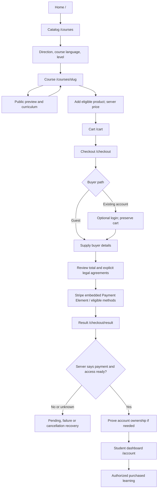
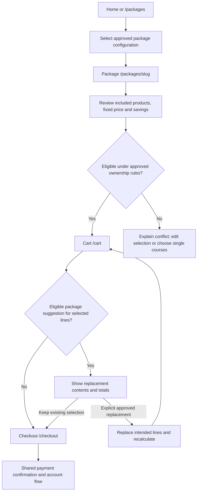
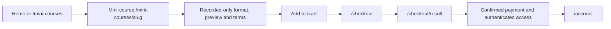
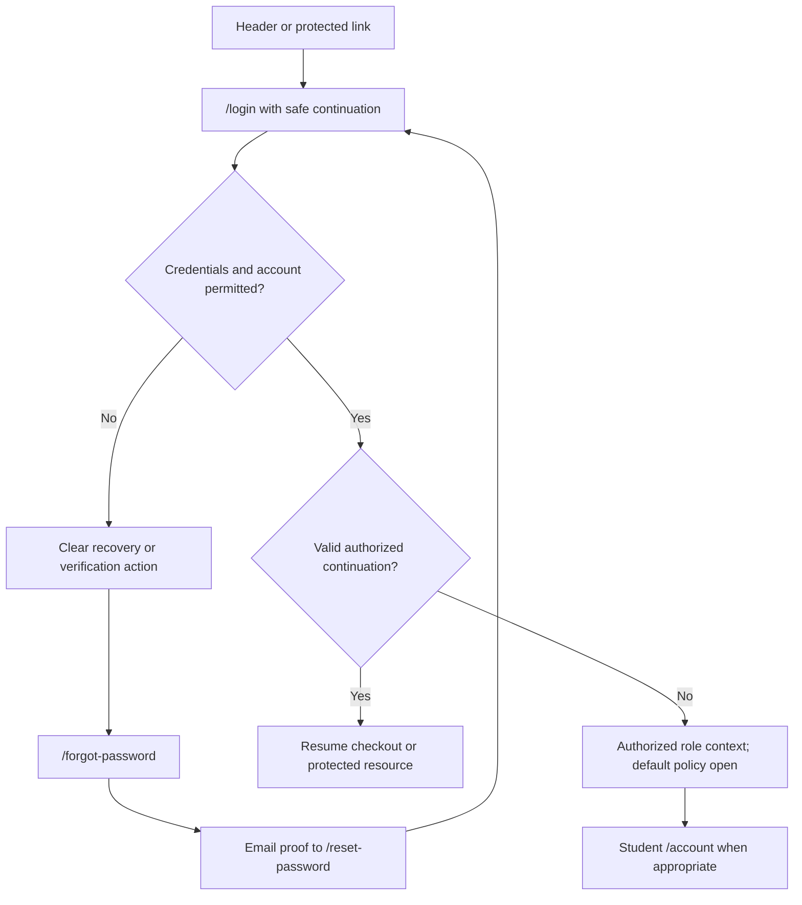
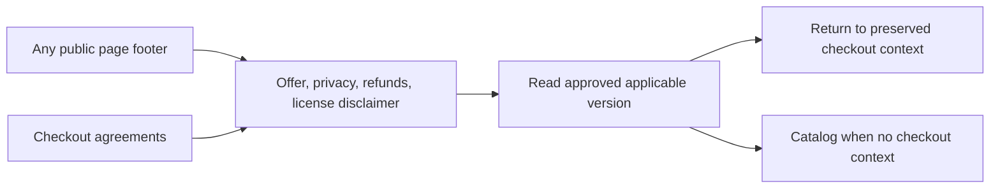
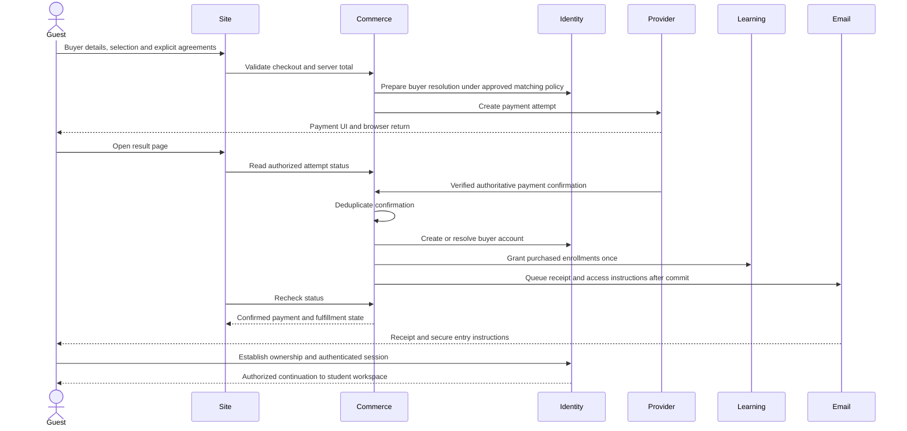

# Public visitor and purchase flows

LA02 · Refined after review · 2026-10-26.

Routes and release labels follow [public-sitemap.md](./public-sitemap.md); page contents follow [public-page-structure.md](./public-page-structure.md). Exact URL/interaction arrangements are recommendations. Business invariants come from [requirements](../product/requirements.md), [scope](../product/mvp.md) and [module workflows](./modules.md). Open policies remain in the [product register](../product/open-questions.md) and [LA02 review register](./public-open-questions.md).

The accepted discovery → commerce → identity/protected-workspace boundaries remain unchanged. Current route decisions are limited to locale URL policy (PA-02) and the protected namespace (PA-03). Policy dependencies below belong to their implementation phases; they do not all need resolution to accept this public architecture.

## Shared purchase contract

**Requirements:** guests and students can select products; checkout may create an account; successful payment creates/resolves the account, creates/fulfills the order, grants purchased access and triggers receipt/access instructions. Card payment is MVP. The original specification explicitly places account creation for a new guest after successful payment. Do not turn mandatory pre-purchase registration into an assumed rule.

**Recommendations:** keep guest buyer details and a checkout identity before payment; optional login resumes the same cart. Only authoritative provider confirmation may fulfill the purchase. Account ownership, payment confirmation and learning authorization are three different checks: a return URL, typed email, reset link or role name cannot substitute for all three.

Existing-account matching (OQ-032), verification timing and guest activation credentials remain unresolved. The diagrams show the required handoffs and proposed recovery paths, not an approved authentication provider/session design.

## 1. Visitor → Catalog → Course → Cart → Checkout → Student dashboard

MVP. Entry may be home, a direct catalog link or a published product URL.

The homepage's recommended core sequence is Hero → Course Discovery → Packages (Phase 2) → Mini-courses → Start in USA (release TBD) → Footer; omit unreleased sections. Category navigation and “How Learning Works” may be added or integrated during visual design. These section arrangements are design recommendations, not immutable implementation requirements or mandatory steps in the purchase flow.

On addition, browsing can continue; cart entry is explicit. Final checkout revalidates publication, sale state, prices and eligibility. Course access/support terms shown before payment must match the eventual entitlement. The student dashboard shows purchased courses and progress, including a clear empty state if no enrollment exists. Protected lesson URLs are outside public IA; `/account/courses/[enrollmentId]` is a proposed handoff target, not a currently implemented route.

## 2. Visitor → Package → Cart → Checkout

Phase 2 only. Public packages must not appear as functional MVP controls.

Recommend explicit replacement consent, preserving unrelated lines and avoiding overlapping duplicate access. This is a proposal under OQ-027; overlap, partial ownership and configuration remain blocked by OQ-025–OQ-028. No proration, automatic credit, quantity change or package certificate is presumed. Published included-course links return to the same selected package context.

## 3. Visitor → Mini-course → Purchase

MVP uses the same cart/checkout engine and legal agreements.

Do not silently skip cart through an ambiguously labeled “Buy” button. If a future direct-purchase action is approved, its destination must still expose the actual selected order and all checkout requirements. Mini-courses have no curator/homework-review promise. Completion of mandatory lessons, not purchase, establishes certificate eligibility under OQ-021/PD-010; every certificate then requires administrator evidence review and manual issuance.

## 4. Existing student → Login → Dashboard

Login/register/recovery/verification must carry a validated internal continuation, such as `/checkout`, without accepting arbitrary external redirects. Never trust client-supplied roles. Invalid or unauthorized continuations fall back to a permitted account entry; expired sessions should not lose cart selection. Multi-role users should continue a purchase in student context, with separate permitted workspace choices; OQ-013 must decide default role behavior. Do not create manager/trainer/admin public sign-up routes.

## 5. Visitor → Legal information

Legal pages never require login. Reading a policy is not consent; the buyer must explicitly acknowledge the required documents at checkout. PD-006 requires notification of policy changes to affected students and renewed acknowledgment at next checkout for material changes; editorial changes require notification only. Published versions are immutable, acceptance records retain timestamps/user/order references, and existing access continues. PD-006 requires explicit acknowledgment of Privacy Policy as well as Terms of Sale, Refund Policy and Licensing Disclaimer. If required approved text is unavailable in the selected language, prevent production payment and explain the failure; do not replace it with generated legal advice.

## 6. Guest purchase → Account creation and access

The required order of authority is payment confirmation → create/resolve account and fulfill once → authenticated access. A provider payment attempt or provisional internal checkout record can exist earlier without being presented as a successful order.

The receipt/access email is an asynchronous effect; its failure does not undo confirmed payment. Fulfillment must recover idempotently if the callback is delayed, delivered twice, or processing is interrupted. The result page distinguishes payment-confirmed/access-preparing from ready; it must not encourage a second purchase to fix missing enrollment.

| Guest case | Required boundary | Recommended experience, subject to approval |
| --- | --- | --- |
| Email not linked to account | Create account after confirmed payment; establish credentials securely | One-time activation entry using verification/password setup components, then `/account`; exact URL/token/session behavior remains PA-05 |
| Email linked to existing account | OQ-032 must define matching; typed email is not ownership proof | Offer sign-in/secure email proof and preserve cart; associate safely without silently exposing or signing into that account |
| User voluntarily registers before paying | Registration alone grants no learning entitlement | Retain cart; verification/login returns to `/checkout`; confirmed payment uses same account |
| Guest returns on same device | Browser return is not payment or account proof | Show only checkout-context-authorized status; learning CTA still requires authenticated owner |
| Guest returns on another device | A guessed order ID must not reveal the order | Secure email entry or login reestablishes access; expired links offer a safe replacement path |
| Receipt/access email delayed | Paid record and enrollment remain durable | Authenticated buyer can open dashboard; guest sees neutral delivery/recovery instructions and approved support channel |

Do not send plaintext passwords, infer email verification from a payment provider redirect, or merge existing accounts by email without the approved matching/ownership policy. These are security recommendations, not provider selections.

## Payment result and retry behavior

| Observed state | Presentation / action | Invariant |
| --- | --- | --- |
| Before payment / invalid checkout | Correct highlighted fields, offer or consents on `/checkout` | No access grant |
| Provider processing or no authoritative result | Pending, recheck existing attempt; approved support after defined delay | Unknown is not failed; no duplicate payment prompt |
| Browser says success but callback absent | Pending confirmation | Browser flag never grants access |
| Payment confirmed, fulfillment preparing | Explain preparation; recheck or operational support | No “pay again”; retries use original purchase identity |
| Confirmed and fulfilled | Order summary for authorized buyer; `/account` or secure account entry | Only intended enrollments; receipt queued independently |
| Authoritatively failed/cancelled | Keep eligible selection; return `/checkout` for a safe new attempt | No paid access; server prevents competing attempt races |
| Result lookup unavailable | “Unable to check status,” retry; retain attempt reference safely | Do not mislabel as failed or paid |
| Duplicate callback, reload or back navigation | Return original outcome | No duplicated order, enrollment or email intent |
| Unknown/unauthorized attempt | Minimal recovery to login/cart/catalog | No order, address or email disclosure |

Stripe is approved by PD-002; payment state mappings, terminal states, retry windows and escalation timing remain under OQ-031 and PA-12. Avoid an invented timeout that turns pending into failed.

## Conditional and later handoffs

- **Start in USA — release TBD:** retain the proposed standalone purchase path `/start-in-usa` → `/cart` → `/checkout` → `/checkout/result` → authenticated `/account`. Enable it only after publication/sale approval; until then omit live inbound navigation. Published Phase 2 packages may expose their approved inclusion path, but do not settle or replace the proposed standalone release. Neither completion nor certification is inferred from mini-course rules.
- **Certificate verification:** QR → `/certificates/verify/[verificationId]` → approved valid/revoked/not-found presentation. No login, public directory or learner-data lookup. Course navigation is optional and only for still-public products. This route is Phase 3, not a prerequisite for MVP PDF issuance.
- **RU/EN — Phase 2:** equivalent translated page retains product identity, cart and applicable filters. Course audio/subtitle availability is independent of interface language. Missing translations require an explicit fallback choice, not silent navigation to an unrelated homepage. Confirming locale URL policy now does not enable English navigation in MVP.

## Implementation dependencies and edge cases

Resolve these before the corresponding feature or launch acceptance, as grouped in the [deferred-decision table](./public-open-questions.md#deferred-decisions-by-implementation-phase). They are not additional LA02 routing gates; existing product-register records and blocking statuses remain intact.

| Risk / confusing transition | Planned prevention or recovery | Dependency |
| --- | --- | --- |
| Unavailable packages, EN, reviews, Start in USA or demo appear clickable in MVP | Omit their links/sections until approved and functioning in their release | Release scope; PA-02/PA-04/PA-13/PA-14 |
| Direction chosen with zero launch products | Explain empty result, reset filters and offer available categories | PD-009 business inventory readiness / OQ-017 |
| Course removed or repriced between catalog and checkout | Revalidate, explain changed line, allow return/remove; no silent charge change | Catalog/Commerce contracts |
| Advanced product selected without approved eligibility rule | Disclose requirement and block unsupported sale path rather than invent document checks | OQ-018 |
| Repeated add, active ownership or expired enrollment | Show existing state; use approved repurchase/overlap policy | PA-10; OQ-026 |
| Anonymous and signed-in carts conflict | Preserve context and show a reconciled server-calculated selection under approved merge policy | OQ-033 |
| Auth, verification or reset loses purchase | Persist safe continuation and cart; revalidate after return | PA-05/06 |
| Login default sends multi-role buyer into trainer tools | Purchase continuation takes priority subject to authorized student context | OQ-013 |
| Guest email typo or existing-email collision after charge | Validate email input; define ownership-safe correction/escalation before launch | OQ-032; PA-05/12 |
| Legal link loses checkout input or agreement versions change | Preserve non-sensitive state, return link, collect current explicit consent | PD-006; residual OQ-007; PA-07 |
| Bank app return/session expiry on mobile | Recover attempt independently of tab session; reauthenticate for order/learning data | PD-002 / OQ-031 |
| Promo fails or package replacement surprises buyer | Explain reason, preserve original selections, require deliberate replacement | OQ-025–OQ-028/OQ-034–OQ-035 |
| Payment succeeds but email/enrollment is delayed | Distinct state, durable retry and real support escalation; no repurchase | PA-12; OQ-069/OQ-080 |
| Refund or expiry removes previously available learning | Show authoritative access state and approved explanation/support; retain history | OQ-003/OQ-036/OQ-037/OQ-048/OQ-049 |
| Verification course has been archived | Retain issuance snapshot/title; omit broken product link | OQ-055/OQ-056 |
| Account blocked | Clear permitted recovery path without granting protected access | OQ-016 |

PD-004 approves server-enforced access/support clocks and revocation. PD-010 requires automatic eligible Stripe refunds and confirmed-refund access revocation in MVP; exceptions/failures escalate to administrators. The seven-day window remains proposed under OQ-037, not final public policy. PD-010 also requires manual administrator issuance after eligibility review for every certificate. Do not infer certificate correction/revocation/reissuance rules.

## Acceptance scenarios for future implementation

Review the diagrams now; run these scenarios when the features exist:

1. RU guest and signed-in student purchase a course and a mini-course; cart survives auth/recovery; only confirmed payment grants access.
2. Existing-email guest, new guest, voluntary registrant and multi-role purchaser reach the correct account without duplication or disclosure under approved policy.
3. Declined/cancelled payment, delayed/duplicate callback, unknown status, interrupted fulfillment and email failure recover without a second charge/access grant.
4. Empty catalog/cart, invalid filters, unpublished slug, stale price, unavailable legal text and unauthorized result each have an actionable exit.
5. Mobile navigation, payment-provider return, keyboard focus and legal reading preserve context; RU/EN equivalent routes behave correctly in Phase 2.
6. Later package overlap/promo errors and certificate valid/revoked/not-found states follow approved policy.

These are planning acceptance scenarios, not tests executed by LA02.
