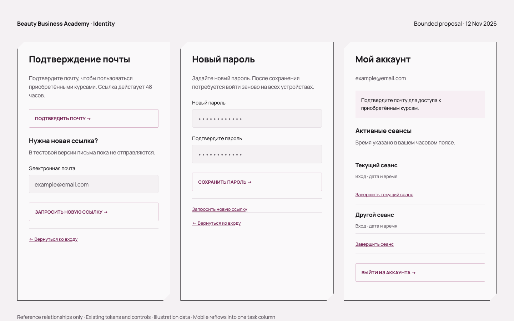

# Identity reference contract · 2026-11-12

Status: bounded implementation proposal requested by the owner, not human visual
approval. Scope: email/password identity only, MVP. No dashboard/role picker,
commerce claims, social login implementation, or new brand direction.

Source: the current website's AuthModal, canonical FormControls and Button, and
2026-11-11 auth refinement (DESIGN.md / public-auth-ui-fixes QA). The existing
390px reference was inspected directly; its mid-animation translucent capture
is not a desired surface. Completed forms must be opaque. No supplied photo,
external brand, invented identity claims, or generated raster copy is used.

The reference board below derives new completion/session panels from those exact
relationships: one task column, short functional Manrope title, off-white frame,
plum action, soft filled controls, inline feedback, quiet secondary return action.
The frame retains the site's existing cut corners; no new decoration or photography.

- **Verification:** instruction → explicit confirmation → result; resend stays
  available after invalid/expired links. No automatic token consumption on GET.
- **Reset:** consequence → new password → repeat password → save → return to login.
- **Account:** email/verification → owned sessions with viewer-local dates → explicit
  session-end confirmation → logout. No invented device/IP labels.
- **Recovery/registration:** honest no-delivery notice; pending, validation, service
  failure and success use the canonical controls. Existing social actions stay disabled.

Desktop: 540px focused column, registration 650px; page starts below existing header.
Mobile: 15px page gutters, 22px inner padding, natural page height. Modal retains
its available-viewport scroll ownership. Minimum QA 1440×900, 768×900, 390×844,
320×844; screenshots test actual fonts, text bounds, keyboard and reduced motion.

Actual working screenshots and route coverage: [audit](../../qa/auth-audit-2026-11-12.md).
